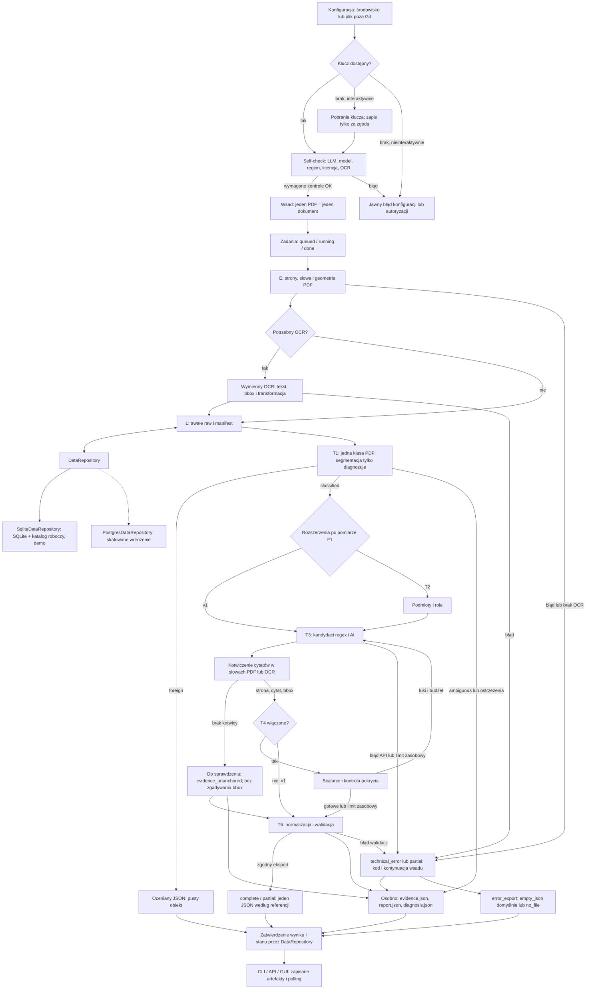

# Architektura wewnętrzna: ELT z OCR i ekstraktorami AI

To projekt działania silnika, nie opis zaimplementowanego produktu. Eksperyment YAML potwierdza kontrakt i serializację referencji; karty lokalizują znane wartości. Żaden z tych wyników nie jest pomiarem F1 ekstrakcji. Decyzje przyjęte określa [ADR-002](../07-decyzje/ADR-002-decyzje-po-recenzji.md); poniżej rozwijamy je w kontrakty. Podstawa: [recenzja pipeline'u Codex](../07-decyzje/konsultacja-pipeline-2026-11-21/codex-odpowiedz.txt), [ocena Fable, §6–7](../07-decyzje/konsultacja-ocena-calosci-2026-11-21/fable-odpowiedz.txt), [wymagania](../03-wymagania/README.md), [odpowiedzi mentora](../01-zadanie/zrodla/odpowiedzi-mentora-2026-11-21.md) i [ocena GUI](gui/ocena-ui-vs-kryteria.txt). Dokument nie zmienia projektu GUI.

## 1. Zasady i warunki wejścia do implementacji

Zasady ADR-002:

- Python 3.13, jeden pakiet, CLI i GUI korzystają z tego samego silnika. Instalacja u jury tylko przez pip, bez Rusta i Dockera; Docker może służyć deweloperom. GUI obowiązkowe, minimum wcześnie, pełna wersja po stabilnym F1.
- Nie ma założonej ścieżki idealnej: diagnozujemy dokument, stronę i docelowo region. Brak tekstu nie oznacza dokumentu obcego. Pewność bez kalibracji pozostaje sygnałem, nie prawdopodobieństwem poprawności.
- Każdy PDF przetwarzamy niezależnie. Wsad grupuje zadania; nie dostarcza kontekstu ekstrakcji. Jeden PDF to jeden dokument i najwyżej jeden oceniany JSON, niezależnie od liczby stron. Nie uzupełniamy danych z innych plików sprawy; segmenty opisują strukturę tego samego PDF.
- Regex służy formatom (np. NIP, rachunek), ekstraktor AI znaczeniu, funkcji dokumentu i rolom. Wzorce wymagają pomiaru i testów mutacyjnych. Etykieta roli jest wskazówką; „ODWOŁANIE” jest tytułem, nie rolą podmiotu.
- Serializuje kod: nazwy, typy, struktura i kolejność kluczy według referencji. Numery identyfikacyjne są tekstem albo `null`. Dowody, diagnozy i powody braków pozostają poza ocenianym JSON-em.
- Braki są jawne: brak, nie dotyczy, nieczytelne, sprzeczne, nieprzetworzone. Niepewna wartość obecna w źródle nie znika automatycznie pod `null`; nie wolno wymyślać danych.
- Obcy dokument daje `{}` pod nazwą wejścia. Błąd techniczny ma odrębny stan, raport i kod; pozostałe dokumenty wsadu są kontynuowane. Potwierdzona polityka eksportu awarii jest w §10; domyślnie nie tworzymy pliku wyniku.
- Własny odczyt PDF i własny model ML OCR pozostają kierunkiem zespołu. Tymczasowy dostawca OCR implementuje ten sam kontrakt (§5); ADR-002 pkt 4 nadal obowiązuje.
- Klient LLM obsługuje protokoły OpenAI i Anthropic zgodnie z ADR-002. Model i API wymagają potwierdzenia otwartej licencji oraz lokalizacji zgodnej z zadaniem. Klucze poza Git i frontendem. Liczymy największy model całego systemu; zakres OCR wymaga odpowiedzi mentora.
- Cache jest optymalizacją tylko dla identycznej tożsamości wyniku. Awaria API nigdy nie uruchamia podmiany na stary wynik.

Warunki wejścia do implementacji (Fable §7, wymagania do spełnienia, nie wykonane prace):

1. Przed kontraktem lub równolegle: loader 60 spraw, ewaluator TP/TN/FP/FN oraz CLI `input` → `output` na atrapie silnika (§11). Zestaw testowy zamrażamy przed budową ekstrakcji.
2. Zastępczy odczyt PDF i OCR za wspólnym kontraktem, zmierzone na rasteryzacji 60 spraw (grupa A). Własny model zastępuje shim po wykazaniu lepszego wyniku przed terminem. Wybór zastępczego czytnika PDF pozostaje do decyzji użytkownika; odrzucenia `pypdfium2` nie cofamy.
3. Jeden dopuszczalny otwarty model hostowany w Europie, wybrany i zmierzony na ścieżce: przelew → pełnomocnictwo → odwołanie. Większy model tylko po wykazanym zysku F1.
4. Stosujemy zamknięte decyzje z §10: pięć wyników, politykę `null` i błędów, jeden PDF = jeden dokument oraz obowiązkowe bbox. Pytania do mentora nie wstrzymują tych decyzji zespołu; dotyczą m.in. oceny eksportu awarii i rozmiaru OCR.
5. OpenAPI v1 ograniczone do systemu, wsadów, dokumentów, diagnozy, wyniku/dowodów/raportu, odczytu klas i kodów. Bbox dowodów są wymagane od v1. Analiza regionów, korekty, użytkowe wersje wyników i zarządzanie rolami pozostają poza v1. Wersje techniczne silnika i artefaktów są wymagane od początku.
6. GUI P0 ograniczone do wgrania i przeglądu, dowodu strona + cytat + bbox, pobrania JSON, karty modeli i gotowości OCR. Stan `ambiguous` i ostrzeżenie o segmentacji pozostają dostępne w kontrakcie; segmentacja nie tworzy osobnego wyniku.
7. Usunięte sprzeczności w dokumentach architektury i tabeli wymagań. Historia zachowana z jawnym pierwszeństwem uzupełnień.

## 2. Etapy i artefakty

Proces to **ELT wzbogacony o warstwę OCR i ekstraktory AI**: najpierw odczyt surowy E, trwały zapis L, potem transformacje. OCR jest częścią pozyskania treści; nie oznacza normalizacji biznesowej. W ETL transformacja przed zapisem utrudniałaby ponowne rozstrzygnięcie ról lub zmianę promptu bez powtarzania OCR. ELT zachowuje surowy tekst, obrazy, diagnozę i pochodzenie, pozwala przeliczać T1–T5, porównywać wersje i mierzyć wpływ każdego etapu. Koszt: więcej miejsca, wymagana retencja i kontrola zgodności artefaktów.

Ścieżki w tabeli są względne do katalogu przebiegu dokumentu (§7). Każdy wewnętrzny artefakt JSON ma metadane `schema_version: 1`, `stage`, `stage_version`, `input_hashes` i `version_manifest_id`; kontrakty i przykłady §4 pokazują treść bez powtarzania tych wspólnych metadanych. Oceniany `result.json` pozostaje wyjątkiem: wyłącznie klucze organizatora, bez obudowy technicznej. Wersja etapu początkowo `1`; zmiana algorytmu lub kontraktu tworzy nową wersję, nigdy ciche nadpisanie.

| Etap | Wejście | Wyjście na dysku | Odpowiedzialność | Wersje zależności | Obsługa błędu |
|---|---|---|---|---|---|
| E: ekstrakcja surowa | bajty PDF | `raw/reading.json`, `raw/diagnosis.json`, obrazy `raw/pages/0001.png`, opcjonalnie obrazy osadzone i surowe odpowiedzi OCR | kod odczytu PDF; OCR tylko tam, gdzie wymaga tego diagnoza | czytnik, renderer, dostawca i model OCR, konfiguracja diagnozy | uszkodzony/zaszyfrowany PDF: błąd; brak OCR: oznacz nieprzetworzone strony, zachowaj odczytane dane |
| L: trwały staging | dane E i obrazy | `raw/manifest.json` ze skrótami, wersjami i listą kompletnych plików | kod | schemat odczytu i manifestu | awaria zapisu: brak zatwierdzonego manifestu, `write_failed` (katalog: `zapis_nieudany`); T nie startuje na niedokończonej warstwie |
| T1: segmenty i router | staging i konfiguracje klas | `t1/segments.json`, `t1/router.json` | kod: sygnały, progi per klasa i odstęp między kandydatami; AI: funkcja dokumentu | profil progów, klasy, prompt/model | decyzja: klasa / obcy / niejednoznaczny / błąd; segmentacja tylko jako ostrzeżenie; jeden wynik dla całego PDF, bez arbitralnego wyboru pierwszego segmentu |
| T2: grupy, podmioty, role | odczyt, segmenty, klasa | `t2/entities.json` z identyfikatorami, relacjami i grupami | AI interpretuje; kod kontroluje identyfikatory i zakresy | strategia grupowania, prompt/model | nierozstrzygnięte role zachowują kandydatów i konflikt; nie przypisuj NIP do przypadkowej osoby |
| T3: kandydaci pól | tekst całego dokumentu, klasa; opcjonalnie T2 | `t3/candidates.json`, `t3/ai-response.json` | regex: formaty; ekstraktor AI: znaczenie, role i pierwszy zarzut; kod: weryfikacja cytatów | wzorce, prompt, model i konfiguracja klasy | niepoprawna odpowiedź: jawny kod; cytat bez pokrycia w źródle nie jest dowodem; zachowaj poprawnych kandydatów z innych źródeł |
| T4: scalanie i pokrycie | kandydaci, oczekiwane pola, zakres przetworzonych stron | `t4/merge.json`, `t4/coverage.json`; kolejne iteracje T3 w osobnych plikach | kod scala wystąpienia i wykrywa konflikty, AI rozstrzyga tylko uzasadnione luki | strategia scalania, limit iteracji, prompt/model | pętla do T3 ma limit wywołań/czasu; po limicie jawne luki, nigdy pozorna kompletność |
| T5: normalizacja i walidacja | wybrani kandydaci lub bezpośrednio T3 w v1 | `t5/canonical.json`, `t5/validation.json` | kod: normalizatory, słowniki, pochodne i walidacja YAML | YAML, słowniki, reguły i rewizja referencji | brak wymaganego nienullowalnego pola: raport i blokada zgodnego eksportu zgodnie z polityką §10; bez pustych zamienników |
| Eksport | zwalidowane T5 lub potwierdzony obcy | `result.json`, `evidence.json`, `report.json`, `diagnosis.json`, `state.json` | kod | serializer i polityka eksportu | zapis atomowy; awaria nie usuwa innych wyników, nie publikuje pliku częściowo zapisanego |

E obejmuje strony, słowa z geometrią, linie, kolejność czytania, obrazy i tekst PDF lub OCR. Diagnoza dokumentu i każdej strony zawiera źródło tekstu, pokrycie, obrót, pewność i sygnały. Strona tekstowa może wymagać OCR: w v1 wolno przetworzyć obraz całej strony i oznaczyć źródła, zamiast od razu budować analizę regionów. Nie sklejamy tekstu OCR i PDF bez kontroli duplikatów. Warstwa źródłowa pozostaje zachowana także po wyborze preferowanego odczytu.

Router rozpoznaje funkcję: wniesienie odwołania, udzielenie umocowania, potwierdzenie wykonanej płatności. Nazwa pliku nie jest sygnałem. Tytuł i słowa kluczowe wspierają decyzję, nie wystarczają do niej. Wyrok cytujący odwołanie i ogłoszenie BZP/TED są trudnymi negatywami; zapisujemy sygnały przeciwne. `foreign` wymaga wystarczającego odczytu i niespełnienia warunków klas. Konflikt kandydatów daje `ambiguous`, awaria odczytu lub API daje `technical_error`; ewentualne `{}` wynika tylko z jawnej polityki eksportu błędów (§10). Progi i minimalny odstęp ustalamy per klasa na zbiorze rozwojowym. Historyczny parametr YAML `min_trafien` odpowiada technicznemu `min_hits`; nie jest jeszcze zmierzoną regułą routera. Ocenianego JSON ani zewnętrznych konfiguracji nie przemianowujemy w tym zleceniu.

## 3. Ścieżka pionowa najpierw

**V1 obejmuje E, L, T1, T3 i T5**, najpierw dla przelewu, następnie pełnomocnictwa i odwołania. Jedno wspólne wywołanie ekstraktora AI na dokument zwraca ocenę funkcji dla T1 i kandydatów dla T3 według dostępnych konfiguracji. Nie robimy osobnego wywołania klasyfikatora ani kolejnego na każde pole. T1 rozstrzyga odpowiedź z sygnałami kodu, T3 zachowuje kandydatów wybranej klasy. Brak czytelnej treści może zakończyć dokument przed wywołaniem AI. Błąd odpowiedzi kończy próbę jawnym stanem; ponowienie to jawna nowa próba, nie ukryta pętla zwiększająca bazowy koszt.

W v1 AI rozpoznaje role w kontekście całego dokumentu i dowodzi wartości cytatami. Nie ma osobnego etapu T2 ani T4, lecz kod już sprawdza listę wymaganych pól i zakres odczytu. Braki po T3 trafiają do raportu; nie ma automatycznej pętli naprawczej. Pominięte etapy mają jawny wpis w manifeście, nie puste artefakty udające wykonanie. Kontrakt nie narzuca limitu stron. Obowiązują wyłącznie limity zasobowe: `limit_kontekstu` / `context_limit` i `limit_czasu` / `time_limit`, z jawnymi nieprzetworzonymi zakresami; nie ucinamy treści po cichu ani nie dzielimy wyniku.

Po pomiarze dochodzą osobno: T2 (role i relacje), T4 (scalanie/pętla pokrycia), analiza regionów, wielokrotne obrysy i OCR regionów. **Kryterium włączenia: etap poprawia F1 na zamrożonym zbiorze rozwojowym**, z raportem per klasa i kosztu czasu, pamięci oraz wywołań. Bez poprawy pozostaje wyłączony. Nie stroimy na zbiorze kontrolnym. Obowiązkowa geometria dowodów w v1 nie zależy od włączenia analizy regionów: pochodzi ze słów PDF lub OCR (§4.5).

## 4. Kontrakty wewnętrzne (schemat v1)

To projekt pól i typów do implementacji, nie nowy format referencyjnego JSON ani gotowy OpenAPI. `string` to tekst, `integer` liczba całkowita, `number` liczba JSON. Identyfikatory są stabilnymi tekstami w obrębie przebiegu. Wszystkie wymienione pola są wymagane, chyba że opis mówi „opcjonalne”; nieznana wartość ma jawne `null`, dopuszczone w typie. Przykłady są syntetyczne.

### 4.1. Warstwa odczytu wspólna dla PDF i OCR

`Reading`: `schema_version: integer`, `document_sha256: string`, `pages: Page[]`. `Page`: `number: integer >= 1`, `width_pt/height_pt: number > 0`, `text: string`, `source: enum(pdf, ocr, mixed, none)`, `words: Word[]`, `lines: Line[]`, `images: Image[]`, `to_pdf: number[9]`. `Word`: `id/text: string`, `line_id: string`, `order: integer`, **`bbox: Bbox`**, `confidence: number[0,1]|null`, `source: enum(pdf, ocr)`. `Line`: `id/text: string`, `words: string[]`, **`bbox: Bbox`**. `Image`: `id/file: string`, `bbox: Bbox`, `sha256: string`.

`Bbox = [x0,y0,x1,y1]`, cztery skończone liczby, `x0<x1`, `y0<y1`, w granicach strony. Wspólny układ: punkty PDF (1/72 cala), początek lewy górny róg strony wyświetlanej po `/Rotate`, x w prawo, y w dół; numer strony oryginału od 1. `to_pdf` jest odwracalną macierzą jednorodną 3×3 do oryginalnego układu PDF. Adapter testuje mapowanie narożników. Pewność tekstu PDF ma `null`, nie sztuczne 1.0.

Czytnik PDF dostarcza bbox słów z warstwy tekstowej. Adapter OCR dostarcza bbox słów w pikselach i transformuje je do punktów strony (§4.2). Linie agregują bbox swoich słów. Tekst bez geometrii można zachować jako surową odpowiedź i wskazać ograniczenie odczytu, ale nie wolno wprowadzić go do listy słów spełniających kontrakt ani uznać za zakotwiczony dowód. Nie zgadujemy bbox.

```json
{"schema_version":1,"document_sha256":"aaaaaaaaaaaaaaaaaaaaaaaaaaaaaaaaaaaaaaaaaaaaaaaaaaaaaaaaaaaaaaaa","pages":[{"number":1,"width_pt":595,"height_pt":842,"text":"Kwota: 200,00 PLN","source":"pdf","words":[{"id":"p1w1","text":"Kwota:","line_id":"p1l1","order":0,"bbox":[40,50,80,62],"confidence":null,"source":"pdf"},{"id":"p1w2","text":"200,00","line_id":"p1l1","order":1,"bbox":[85,50,125,62],"confidence":null,"source":"pdf"},{"id":"p1w3","text":"PLN","line_id":"p1l1","order":2,"bbox":[130,50,160,62],"confidence":null,"source":"pdf"}],"lines":[{"id":"p1l1","text":"Kwota: 200,00 PLN","words":["p1w1","p1w2","p1w3"],"bbox":[40,50,160,62]}],"images":[],"to_pdf":[1,0,0,0,1,0,0,0,1]}]}
```

Każdy `line_id` wskazuje istniejącą linię; lista `words` linii wskazuje istniejące słowa tej strony. Identyfikatory zachowują powiązanie tekstu z geometrią także po normalizacji białych znaków.

### 4.2. Komponent OCR

Wejście `OcrRequest`: `image: string` (plik), `page: integer`, `region: Bbox|null`, `dpi: number > 0`, `width_px/height_px: integer`, `orientation_degrees: number|null`. Region określa wycinek strony w punktach PDF. Wyjście `OcrResponse`: `lines: OcrLine[]`, `words: OcrWord[]`, `rotation_degrees: number`, `confidence: number[0,1]|null`, `to_page: number[9]`, `provider: OcrProviderInfo`. Linie i słowa mają `id/text: string`, `bbox: number[4]` w pikselach obrazu wejściowego oraz `confidence: number[0,1]|null`; słowo wskazuje `line_id`. Adapter cofa obrót/prostowanie dostawcy przed zwróceniem bbox; `to_page` mapuje współrzędne wejściowego obrazu do wspólnego układu strony. Brak słów przy dostępnych liniach jest jawnym ograniczeniem dostawcy; bez geometrii słów nie potwierdzamy dowodu w §4.5. Bbox OCR musi być niepusty i mieścić się w obrazie; adapter mapuje wszystkie narożniki i wyznacza obrys w układzie strony.

`OcrProviderInfo`: `available: boolean`, `name: string`, `version: string|null`, `parameter_count: integer|null` (suma komponentów modelu dostawcy; podział modeli w manifeście), `license: string|null`, `location: string|null`, `models: ModelInfo[]`. `ModelInfo`: `name/role: string`, `version/license/location: string|null`, `parameter_count: integer|null`. Nieznane metadane są jawne i blokują potwierdzenie zgodności konkursowej; liczby nie są szacowane z nazwy modelu.

```json
{"image":"raw/pages/0001.png","page":1,"region":null,"dpi":144,"width_px":1190,"height_px":1684,"orientation_degrees":null}
```

```json
{"lines":[{"id":"l1","text":"Kwota","bbox":[80,100,160,124],"confidence":0.91}],"words":[{"id":"w1","line_id":"l1","text":"Kwota","bbox":[80,100,160,124],"confidence":0.91}],"rotation_degrees":0,"confidence":0.91,"to_page":[0.5,0,0,0,0.5,0,0,0,1],"provider":{"available":true,"name":"test-shim","version":"1","parameter_count":null,"license":null,"location":"local","models":[]}}
```

### 4.3. Diagnoza dokumentu, strony i opcjonalnie regionu

`Diagnosis`: `schema_version: integer`, `text_source: enum(pdf, ocr, mixed, none, unknown)`, `coverage: number[0,1]|null` (obszar obrazu z treścią objęty odczytem, nie odsetek poprawnych pól), `rotation_degrees: number|null`, `confidence: number[0,1]|null`, `method: string`, `requires_ocr: boolean|null`, `signals: Signal[]`, `codes: string[]`, `pages: PageDiagnosis[]`. Dokument agreguje diagnozy stron, nie maskuje ich średnią. `PageDiagnosis` ma te same pola bez `pages` i dodatkowo `number: integer`, opcjonalnie `regions: RegionDiagnosis[]` z `id: string`, `bbox: Bbox`. `Signal`: `code: string`, `value: string|number|boolean|null`, `description: string`. Kod sygnału jest nazwą pomiaru; kody odstępstw pochodzą z katalogu.

```json
{"schema_version":1,"text_source":"none","coverage":0,"rotation_degrees":null,"confidence":null,"method":"diagnosis-v1","requires_ocr":true,"signals":[{"code":"pdf_word_count","value":0,"description":"Brak słów; obraz pokrywa stronę"}],"codes":["scan","ocr_unavailable"],"pages":[{"number":1,"text_source":"none","coverage":0,"rotation_degrees":null,"confidence":null,"method":"diagnosis-v1","requires_ocr":true,"signals":[],"codes":["scan","ocr_unavailable"]}]}
```

### 4.4. Decyzja routera

`ClassDecision`: `decision: enum(classified, foreign, ambiguous, technical_error)`, `class_id: string|null`, `document_id: string`, `segment_ids: string[]`, `candidates: ClassCandidate[]`, `sufficient_reading: boolean`, `codes: string[]`. Kandydat: `class_id: string`, `score/threshold/min_margin: number`, `supporting_signals/opposing_signals: Signal[]`. Ocena nie musi być prawdopodobieństwem. Identyfikatory klas wewnętrznych: `appeal`, `power_of_attorney`, `bank_transfer`; serializer mapuje je na niezmienione struktury i klucze organizatora.

`Segment`: `id: string`, `pages: integer[]`, opcjonalnie `regions: RegionDiagnosis[]`. Segmenty służą diagnozie struktury jednego PDF. Nie tworzą odrębnych dokumentów ani eksportów. Router podejmuje jedną decyzję dla całego PDF; nierozstrzygnięty konflikt funkcji daje `ambiguous`, nie nowy wynik „wiele dokumentów”. Samo ostrzeżenie o segmentacji nie blokuje eksportu poprawnego wyniku.

```json
{"decision":"ambiguous","class_id":null,"document_id":"doc1","segment_ids":["seg1"],"sufficient_reading":true,"candidates":[{"class_id":"appeal","score":0.6,"threshold":0.7,"min_margin":0.1,"supporting_signals":[{"code":"function","value":"wniesienie odwołania","description":"Ocena AI"}],"opposing_signals":[{"code":"function","value":"rozstrzygnięcie","description":"Możliwy wyrok KIO"}]}],"codes":["class_ambiguous"]}
```

Liczby przykładu są ilustracją kontraktu, nie zaakceptowanymi progami.

### 4.5. Kandydat pola i dowód

`FieldCandidate`: `id/field: string` (pole jako JSON Pointer do kluczy organizatora), `entity_id/group_id: string|null`, `raw_value: string|number|boolean|null`, `method: enum(regex, ai, rule)`, `presence: enum(present, missing, unknown)`, `confidence: number[0,1]|null`, `conflict: boolean`, `review_required: boolean`, `codes: string[]`, `evidence_ids: string[]`. To kandydat, nie gotowy wynik; typ kanoniczny ustala T5 według YAML. Identyfikatory list w modelu podmiotów mapujemy na indeksy dopiero przy eksporcie.

`Evidence`: `id/document_sha256/field: string`, `entity_id/group_id: string|null`, **`page: integer >= 1`**, **`quote: string`**, `words: string[]` (co najmniej jeden identyfikator), **`bbox: Bbox[]` (co najmniej jeden obrys)**, `source: enum(pdf, ocr, rule)`, `rule: string|null`, `premise_ids: string[]`. Każdy dowód ma stronę, cytat i bbox z warstwy odczytu. Wartość pochodna wymaga dodatkowo reguły i dowodów przesłanek; jej dowód wskazuje rzeczywistą geometrię cytowanej przesłanki, nie wymyśloną lokalizację wyliczonej wartości. Dla wielu stron powstają osobne dowody ze wspólnym `group_id`.

Kotwiczenie cytatu AI wykonuje kod: dopasowuje cytat do słów `Reading` na wskazanej stronie, z kontrolowaną normalizacją białych znaków i zachowaniem mapy do identyfikatorów słów. Sprawdza treść, kolejność oraz jednoznaczność wystąpienia; zapisuje cytat źródłowy i bbox tych słów (np. scalone w obrębie linii). Cytat obejmujący PDF i OCR dzielimy na dowody według źródła. AI nie wyznacza współrzędnych. Kilka możliwych kotwic wymaga rozstrzygnięcia z kontekstu; nie wybieramy arbitralnie pierwszej.

Brak dopasowania lub geometrii oznacza pole **„do sprawdzenia”**: `review_required: true`, proponowany kod `evidence_unanchored` (§6), cytat zachowany w `ai-response.json`. Nie tworzymy obiektu `Evidence` bez bbox, nie zgadujemy geometrii i nie zatwierdzamy takiej wartości bez innego poprawnego dowodu. Raport wskazuje kandydata i powód `unprocessed` (brak kotwicy) albo `conflicting` (nierozstrzygnięte wystąpienia); wartość robocza pozostaje dostępna do sprawdzenia. Gdy brak innego dowodu, eksport ma `null` tylko tam, gdzie pozwala schemat; w przeciwnym razie jest blokowany (§10). Wynik nie może być `complete`.

```json
{"id":"c1","field":"/przelew_bankowy/kwota","entity_id":null,"group_id":"bank_transfer","raw_value":"200,00 PLN","method":"regex","presence":"present","confidence":null,"conflict":false,"review_required":false,"codes":[],"evidence_ids":["e1"]}
```

```json
{"id":"e1","document_sha256":"aaaaaaaaaaaaaaaaaaaaaaaaaaaaaaaaaaaaaaaaaaaaaaaaaaaaaaaaaaaaaaaa","field":"/przelew_bankowy/kwota","entity_id":null,"group_id":"bank_transfer","page":1,"quote":"Kwota: 200,00 PLN","words":["p1w1","p1w2","p1w3"],"bbox":[[40,50,160,62]],"source":"pdf","rule":null,"premise_ids":[]}
```

### 4.6. Raport braków, stan i błąd techniczny

`GapReport`: `schema_version: integer`, `gaps: Gap[]`, `processed_pages/unprocessed_pages: integer[]`, `codes: string[]`. `Gap`: `field: string`, `review_required: boolean`, `codes: string[]`, `reason: enum(missing, not_applicable, unreadable, conflicting, unprocessed)`, `description: string`, `evidence_ids: string[]`, `candidates: string[]`. `missing` oznacza brak w przeanalizowanym źródle; `not_applicable` brak zastosowania pola; `unreadable` próbę odczytu bez wiarygodnej treści; `conflicting` konflikt źródeł; `unprocessed` pominięcie/awarię etapu lub zakresu. Tych powodów nie wolno utożsamiać z jednym progiem pewności.

```json
{"schema_version":1,"gaps":[{"field":"/przelew_bankowy/kwota","reason":"unprocessed","review_required":false,"codes":["ocr_unavailable"],"description":"Strona wymaga niedostępnego OCR","evidence_ids":[],"candidates":[]}],"processed_pages":[],"unprocessed_pages":[1],"codes":["ocr_unavailable"]}
```

`DocumentState`: `progress: enum(queued, running, done)`, `outcome: enum(complete, partial, foreign, ambiguous, technical_error)|null`, `stage: string|null`, `class_id: string|null`, `codes: string[]`, `result_file: string|null`, `errors: TechnicalError[]`. Stan wyniku jest `null` przed rozstrzygnięciem; `done` nie oznacza sukcesu. `TechnicalError`: `stage/code/description: string`, `retryable: boolean`, `attempt: integer >= 1`, `page: integer|null`. Opis jest bez kluczy API i treści dokumentu.

```json
{"progress":"done","outcome":"technical_error","stage":"T3","class_id":null,"codes":["llm_unavailable"],"result_file":null,"errors":[{"stage":"T3","code":"llm_unavailable","description":"Brak połączenia z API","retryable":true,"attempt":1,"page":null}]}
```

## 5. Shim OCR

Propozycja tymczasowego dostawcy: **rapidocr + onnxruntime, pip, CPU**, za `OcrRequest/OcrResponse`. To nie przyjęcie rapidocr jako rozwiązania docelowego. Własny model ML zespołu zastępuje adapter i metadane, bez zmian w T1–T5, CLI ani GUI; ADR-002 pkt 4 pozostaje bez zmian. Przed implementacją sprawdzamy dostępność kół dla Python 3.13 i systemów docelowych, licencje kodu i wag, dostarczenie wag przez pip bez systemowych binarek, parametry modeli, polskie znaki, czas i RAM na i7/16 GB bez GPU. To warunki akceptacji propozycji, nie potwierdzone właściwości wybranej wersji.

Dostawca wyłączony ma nazwę `none`:

```json
{"available":false,"name":"none","version":null,"parameter_count":null,"license":null,"location":null,"models":[]}
```

Diagnoza działa mimo tego: oznacza wymagające OCR strony, daje `ocr_unavailable` (katalog: `ocr_niedostepny`), a pola z nich mają powód `unprocessed`. Część odczytana może dać wynik częściowy, jeśli przechodzi uzgodniony kontrakt; czysty skan bez odczytu daje błąd techniczny, nigdy obcy. Gotowość systemu ujawnia faktyczną dostępność OCR i metadane wszystkich modeli. Diagnoza bez OCR nie jest dowodem obsługi skanów.

## 6. Stany i kody wykonawcze

Postęp opisuje pracę (`queued`, `running`, `done`), a wynik jej rezultat. Pięć wyników od v1: `complete` — właściwe pola rozstrzygnięte i JSON zwalidowany (legalne `null` jest możliwe); `partial` — część danych z jawnymi brakami; `foreign` — potwierdzony dokument spoza klas, eksport `{}`; `ambiguous` — nierozstrzygnięta klasa; `technical_error` — awaria uniemożliwiająca wiarygodny wynik. `done` nie oznacza sukcesu. Brak odczytu blokuje decyzję `foreign`, naruszenie schematu lub brak wymaganej geometrii blokuje `complete`. Poprawna część danych może współistnieć z błędem strony w raporcie. Segmentacja nie jest stanem wyniku ani powodem podziału eksportu.

Polskie kody w [kanonicznej taksonomii](../05-weryfikacja/przypadki-brzegowe.json) zachowujemy bez zmian. **Proponowane mapowanie** na angielskie kody techniczne `snake_case` w API, CLI i artefaktach poniżej stanowi warstwę tłumaczenia, nie drugi katalog definicji. Adapter korzysta z katalogu, zachowuje znaczenie i umożliwia mapowanie w obie strony; GUI otrzymuje te same kody co CLI. Przed wdrożeniem adaptera każdy pozostały kod katalogu wymaga jawnego, jednoznacznego odpowiednika; nie wypuszczamy polskich kodów jako awaryjnej wartości technicznej. Kod nie jest stanem wyniku; wpływ zależy od zakresu błędu.

| Kod katalogu (bez zmian) | Proponowany kod API |
|---|---|
| `ocr_niedostepny` | `ocr_unavailable` |
| `ocr_blad` | `ocr_error` |
| `pdf_uszkodzony` | `pdf_corrupted` |
| `pdf_zaszyfrowany` | `pdf_encrypted` |
| `llm_niedostepny` | `llm_unavailable` |
| `llm_autoryzacja` | `llm_authorization` |
| `llm_limit` | `llm_rate_limit` |
| `llm_odpowiedz_niepoprawna` | `llm_invalid_response` |
| `konfiguracja_niepoprawna` | `invalid_configuration` |
| `limit_czasu` | `time_limit` |
| `limit_kontekstu` | `context_limit` |
| `zapis_nieudany` | `write_failed` |
| `walidacja_wyniku_nieudana` | `result_validation_failed` |
| `klasa_niejednoznaczna` | `class_ambiguous` |
| `skan` | `scan` |
| `strona_mieszana` | `mixed_page` |
| `dokument_mieszany` | `mixed_document` |
| `niska_jakosc` | `low_quality` |
| `zla_warstwa_ocr` | `invalid_ocr_layer` |
| `uciety_tekst` | `clipped_text` |
| `dokument_obcy` | `foreign_document` |
| `brak_informacji_wprost` | `information_not_explicit` |
| `dane_dalej_niz_3_strona` | `data_after_page_3` |
| `podobny_do_klasy` | `class_lookalike` |
| `wiele_dokumentow` | `multiple_documents` |

`multiple_documents` jest wyłącznie ostrzeżeniem diagnozy; `foreign_document` opisuje rozpoznanie dokumentu obcego. Nowa propozycja `evidence_unanchored` (polski odpowiednik: `dowod_niezakotwiczony`) dotyczy cytatu bez jednoznacznej kotwicy z bbox; katalogu nie rozszerzamy w tym zleceniu. Odrębny błąd struktury odpowiedzi LLM nadal ma kod `llm_invalid_response`.

Kody grupy `wykonanie` wymagają testów wstrzykiwania awarii: wyłączony i wadliwy OCR, uszkodzony/zaszyfrowany PDF, sieć, 401/403, 429/budżet, wadliwa odpowiedź, konfiguracja, limity czasu/kontekstu, zapis i walidacja. Test kotwiczenia obejmuje brak cytatu, duplikaty cytatu, brak geometrii, obrót i transformację OCR. Zera kodów wykonawczych w kartach nie są testem odporności; karty nie uruchamiają silnika produktu.

## 7. Katalog roboczy i trwałość

Projektowana implementacja v1 `SqliteDataRepository` (wersja demo) trzyma metadane, zadania i stany w SQLite (biblioteka standardowa, bez serwera bazy), a dokumenty, artefakty i wyniki w katalogu roboczym, za interfejsem z §9. Identyfikatory techniczne są niezależne od nazw wejścia. Układ katalogu:

```text
work/<batch_id>/
  batch.json                        # ścieżki względne input/output, stan dokumentów
  events.jsonl                      # zdarzenia wsadu bez treści i sekretów
  documents/<document_id>/
    input.pdf                       # kopia niezmienionych bajtów, SHA-256
    runs/<run_id>/
      versions.json                 # klucz wyniku, modele, konfiguracje i skróty
      raw/manifest.json
      raw/reading.json
      raw/diagnosis.json
      raw/pages/0001.png
      raw/images/                   # opcjonalne obrazy osadzone
      raw/ocr/                      # odpowiedzi i transformacje
      t1/segments.json
      t1/router.json
      t2/entities.json              # po włączeniu T2
      t3/candidates.json
      t3/ai-response.json
      t4/merge.json                 # po włączeniu T4
      t4/coverage.json
      t5/canonical.json
      t5/validation.json
      result.json                   # tylko jeśli dozwolony eksport
      evidence.json
      report.json
      diagnosis.json
      state.json
      events.jsonl
output/<original_subdirectories>/<basename>.json
```

Plik zapisujemy do pliku tymczasowego na tym samym systemie plików, opróżniamy bufor i atomowo zastępujemy cel. Manifest zatwierdzamy na końcu; czytelnik widzi wyłącznie zatwierdzony zestaw o zgodnych skrótach. JSONL zapisuje pojedynczy właściciel zadania; po awarii niepełna ostatnia linia nie zatwierdza wyniku. Jeden dokument ma jednego aktywnego wykonawcę. Ponowienie tworzy nowy przebieg; odświeżenie GUI nie tworzy nowego wywołania AI.

Każdy dokument ma osobne wyjątki, stan, budżet i katalog. Awaria jednego nie zatrzymuje wsadu; podsumowanie wskazuje błędy i pozostałe wyniki. Propozycja kodów wyjścia CLI: 0 — wszystkie zakończone zgodnym eksportem, 1 — co najmniej jeden nierozstrzygnięty wynik lub błąd, 2 — wsad nie wystartował przez konfigurację. Kod liczbowy CLI nie zastępuje kodów dokumentu. Kolizje nazw i wyjście poza katalog przez ścieżkę względną są odrzucane przed pracą. Nowy wsad ma własny katalog wyjścia, żeby stary plik nie uchodził za wynik nieudanej próby.

Zwykłe logi: etap, czas, liczba stron, ponowienia, zużycie API, kod i identyfikator. Tekst, obrazy, dowody i surowa odpowiedź AI są wyłącznie w chronionym katalogu roboczym, bez kluczy API. Retencję i czyszczenie katalogu ustalamy przed udostępnieniem serwera; nie jest to zależność od bazy ani pełnego audytu użytkowników.

## 8. Wersjonowanie i cache

Tożsamość wyniku to SHA-256 kanonicznego manifestu: **skrót bajtów dokumentu + wersja silnika + skrót i wersja konfiguracji klas + prompt + dokładny model LLM + dostawca OCR**. Manifest dodatkowo zawiera schematy, czytnik/renderer PDF, wersje wag OCR, słowniki, parametry generowania, profil routera, politykę `null`/eksportu i flagi etapów. Model oznacza dostawcę, identyfikator rewizji oraz protokół/endpoint, a nie sam ruchomy alias. Nieutrwalona rewizja oznacza brak bezpiecznego ponownego użycia cache. Sekret nie jest częścią manifestu; zmiana endpointu jest.

Cache tylko dla identycznego klucza, kompletnych plików i zgodnych skrótów. Warstwa E/L może mieć osobny klucz zależny wyłącznie od PDF, odczytu i OCR, dzięki czemu zmiana T3 nie powtarza OCR. Reużycie raw nie uprawnia do reużycia starego wyniku T5. Cache nie obejmuje nieudanych i niezatwierdzonych prób. Po błędzie API zapisujemy bieżący błąd; wcześniejszy wynik może być dostępny wyłącznie jako jawna historia, nigdy automatyczny wynik tej próby.

## 9. Model wykonania i repozytorium danych

Model: zadania z odpytywaniem, ograniczona współbieżność, wspólny silnik CLI/API. Przyjęcie plików tworzy wsad, dokumenty i zadania. CLI czeka na te same zadania, GUI odpytuje stan. Restart nie odtwarza pamięci procesu: przerwane `running` zostają oznaczone `done/technical_error` z raportem przerwania; jawne ponowienie tworzy nowy `run_id`. Samo odświeżenie nie uruchamia AI ponownie.

Silnik zależy od **`DataRepository`**, nie od ścieżek dyskowych ani SQL. Wspólne rekordy: `Job` (`id`, `batch_id`, `document_id`, `run_id`, `state`, `revision`), `Document` (`id`, `input_path`, `sha256`), `Artifact` (`id`, `run_id`, `stage`, `schema_version`, `sha256`, `media_type`, `storage_key`) i `Result` (`run_id`, `outcome`, `result_artifact_id`, `evidence_artifact_id`, `report_artifact_id`). Referencje wyniku mogą być `null`, gdy artefakt nie powstał. `storage_key` jest nieprzezroczysty dla silnika.

| Operacja interfejsu | Kontrakt |
|---|---|
| `create_batch(batch)`, `get_batch(batch_id)` | rejestracja i odczyt wsadu oraz listy niezależnych zadań |
| `put_document(document, content)`, `get_document(document_id)`, `open_document(document_id)` | niezmienne bajty PDF ze skrótem i zachowaną względną nazwą wejścia |
| `create_job(job)`, `get_job(job_id)`, `list_jobs(batch_id)` | trwały stan i identyfikator próby; odczyt nie uruchamia pracy |
| `claim_job(job_id, expected_revision)`, `update_job(job_id, state, expected_revision)` | atomowe przejęcie/zmiana stanu; jeden wykonawca, konflikt rewizji odrzuca zapis |
| `put_artifact(run_id, artifact, content)`, `open_artifact(artifact_id)` | zapis niezmiennego artefaktu i weryfikacja skrótu; niekompletny zapis niewidoczny |
| `commit_run(run_id, manifest, result, state)` | atomowe logiczne zatwierdzenie manifestu, wyniku i końcowego stanu; publikacja po sprawdzeniu wszystkich artefaktów |
| `get_result(run_id)`, `list_runs(document_id)` | odczyt wyłącznie zatwierdzonych wyników i jawnej historii |

V1 (wersja demo, decyzja zamknięta w ADR-002): **`SqliteDataRepository` — SQLite (biblioteka standardowa Pythona) dla metadanych, zadań i stanów + katalog roboczy na dysku dla plików i artefaktów**, bez serwera bazy i bez zewnętrznej kolejki. Blokady i atomowy znacznik zatwierdzenia zapewniają kontrakt w jednym procesie wykonawcy; czytelnicy widzą stan zgodny z zatwierdzonym manifestem. Manifest dyskowy jest źródłem zatwierdzenia artefaktów, a indeks po restarcie jest uzgadniany z manifestami. Koszt: zajętość dysku, sprzątanie i ograniczenie współbieżności zapisu; zysk: uruchomienie u jury tylko przez pip i ponowne transformacje bez OCR.

Skalowane wdrożenie (decyzja zamknięta w ADR-002): **`PostgresDataRepository` — PostgreSQL**. Ten sam interfejs i testy kontraktowe; transakcje, rewizje i blokady zastępują mechanikę plikową. Duże artefakty mogą pozostać w magazynie plików za `storage_key`; zatwierdzenie referencji następuje po trwałym zapisie i sprawdzeniu skrótów. Zysk: wielu wykonawców i współdzielone metadane; koszt: serwer, migracje, sterownik i utrzymanie. PostgreSQL nie jest zależnością wariantu jury. To rozwinięcie decyzji ADR-002 przed OpenAPI, bez zmiany stosu w kodzie.

### 9.1. Konfiguracja i samosprawdzenie

Źródła: zmienne środowiskowe (np. `ODWOLANIA2JSON_API_KEY`, `ODWOLANIA2JSON_MODEL`, `ODWOLANIA2JSON_ENDPOINT`) oraz plik użytkownika poza Git, np. `~/.config/odwolania2json/config.toml`. Pierwszeństwo mają zmienne środowiskowe, dalej plik, dalej bezpieczne wartości domyślne. Konfiguracja określa protokół, endpoint, model, region, OCR, limity zasobowe, repozytorium i `error_export`; nie trafia do frontendu ani artefaktów wraz z sekretami.

Przy braku klucza w trybie interaktywnym CLI prosi o niego z ukryciem znaków. Klucz jest domyślnie tylko w pamięci; zapis w pliku użytkownika wymaga osobnej zgody i ograniczonych uprawnień pliku. Następnie program wykonuje self-check: połączenie, autoryzacja, dostępność i zgodność modelu z konfiguracją, region usługi oraz gotowość OCR. Dopiero pozytywny wynik wymaganych kontroli pozwala kontynuować. 401/403 nie uruchamia pętli ponowień; sieć/429 mają ograniczony budżet prób i czasu. Region i licencja wynikają ze zweryfikowanych metadanych dostawcy i konfiguracji, nie z samej odpowiedzi HTTP. Niepotwierdzona licencja/lokalizacja blokuje deklarację zgodności konkursowej.

Self-check raportuje też wersje i parametry wszystkich modeli, w tym największy model; ujawnia brak OCR. Tryb wymagający skanów blokuje pracę bez gotowego OCR. Jawny tryb ograniczony do tekstu może działać po pomyślnych kontrolach LLM, ale każda napotkana strona wymagająca OCR dostaje `ocr_unavailable` i obsługę z §5/§10. Brak OCR nie daje pozornej gotowości konkursowej.

W trybie nieinteraktywnym (batch bez terminala, API) brak klucza daje jawny błąd `llm_autoryzacja` → `llm_authorization`, a wadliwa konfiguracja/model/region — `konfiguracja_niepoprawna` → `invalid_configuration`; brak oczekiwania na wpisanie klucza. Nie logujemy sekretów. Polecenie CLI **`selfcheck`** uruchamia te same kontrole, zwraca raport i niezerowy kod przy niepowodzeniu. API udostępnia **`GET /system`** ze stanem ostatniej kontroli, jej czasem, gotowością LLM/OCR, metadanymi modeli, licencją, regionem i kodami błędów; **`GET /health`** opisuje żywotność procesu. Odczyt stanu nie wykonuje płatnego wywołania LLM. Start przetwarzania sprawdza aktualność self-check i zmianę konfiguracji; nie wymaga restartu tylko po to, by przyjąć klucz.

## 10. Decyzje przed OpenAPI — zamknięte i otwarte

Poniższe decyzje zespołu są **zamknięte** na podstawie ostatniego uzupełnienia ADR-002. Nie zmieniają kontraktu organizatora ani nie udają odpowiedzi mentora.

| Zakres | Obowiązująca decyzja |
|---|---|
| Braki i wymagane pola | Model roboczy dopuszcza `null` z jawnym powodem (§4.6). Nie używamy `""` jako zamiennika. Eksport przechodzi osobną walidację referencyjnego schematu; brak wymaganego nienullowalnego pola blokuje eksport i daje `result_validation_failed`. Zmiana nullable wymaga zatwierdzenia i testu zgodności. |
| Błąd techniczny / brak OCR | Raport, jawny stan i kod, kontynuacja wsadu, niezerowy kod CLI, zapis atomowy. `error_export: enum(no_file, empty_json)`, **domyślnie `empty_json`** (decyzja użytkownika: potwierdzona rekomendacja „przełącznik, domyślnie `{}` z wpisem w raporcie”; README organizatora wymaga JSON dla każdego pliku wejściowego, a dla nieodczytanego negatywu `{}` jest poprawne). `empty_json` zapisuje `{}`, lecz wynik nadal jest `technical_error`, nigdy `foreign`, a raport i kod CLI jawnie wskazują awarię. Odpowiedź mentora o ewaluacji może uzasadnić późniejszą zmianę ustawienia. Poprawna część danych może dać `partial`, jeśli eksport przechodzi schemat i ma wymagane dowody. |
| Dokument obcy | `foreign` → dokładnie `{}` pod nazwą bazową PDF, z zachowaniem podfolderów. Brak odczytu nie jest rozpoznaniem obcego. |
| Jednostka dokumentu | Jeden PDF = jeden dokument, dowolna liczba stron, najwyżej jeden oceniany JSON. Segmentacja tylko diagnozuje i ostrzega; nie eksportuje tablicy dokumentów ani pierwszego segmentu jako zastępstwa całości. Konflikt klas może dać `ambiguous`, bez eksportu do rozstrzygnięcia. |
| Geometria | Każdy dowód ma stronę, cytat i bbox. Kotwiczenie w słowach PDF/OCR obowiązkowe; brak kotwicy oznacza „do sprawdzenia” i kod, bez zgadywania (§4.5). |
| Nazwy i stany | Kod, API, pliki, identyfikatory i kody techniczne po angielsku. Pięć wyników i trzy stany postępu z §6. Wyjątki: wejściowe nazwy użytkownika, klucze ocenianego JSON i wskazujące je JSON Pointery. Dokumentacja i opisy dla użytkownika po polsku; mapowanie katalogu proponuje §6. |
| Klucz i konfiguracja | Środowisko lub plik poza Git; interaktywne pobranie brakującego klucza, self-check przed kontynuacją, zapis tylko za zgodą. Nieinteraktywnie jawny błąd (§9.1). |
| OCR | Wymienny kontrakt, tymczasowy shim i własny model docelowy bez zmiany decyzji ADR-002. Akceptacja konkretnej wersji shima wymaga kontroli z §5; ten dokument nie wybiera jej za użytkownika. |

### Pozostałe decyzje otwarte

| Zakres | Stan / konsekwencja |
|---|---|
| Trwałość | **Zamknięte** (ADR-002): demo na SQLite + katalog roboczy na dysku; PostgreSQL przy skalowanym wdrożeniu, za tym samym `DataRepository`. |
| Dostawca i model LLM | **Zamknięte** (ADR-002 pkt 8 i uzupełnienie): MiniMax hostowany w Europie, protokół zgodny z Anthropic; klient niezależny od dostawcy. |
| Biblioteka UI | Decyzja użytkownika (ADR-002 pkt 10): React, TypeScript, Zod, Next.js (statyczny eksport w pip), gluestack-ui; PDF: `@react-pdf/renderer` (generowanie) i `react-web-pdf-editor` (podgląd; worker lokalnie, programowe ramki dowodów do sprawdzenia). |
| Pytania do mentora | [Rejestr pytań](../07-decyzje/pytania-otwarte.md): miara 80%, normalizacja/agregacja i punktacja modeli, kanał/budżet klucza i konta jury, generator skanów, ocena wielu treści w PDF, nieczytelne pola, eksport awarii i udział OCR w rozmiarze modelu. Odpowiedzi nie cofają automatycznie zamkniętych decyzji zespołu. |

Zakres zasobów v1: `/health`, `/system`, `/batches` (utworzenie i stan), `/jobs` (stan i jawne retry), `/documents` (stan, PDF, obraz i tekst strony), diagnoza, wynik, dowody i raport, odczyt klas/YAML/schematów i kodów. Nazwy zagnieżdżonych zasobów: `diagnosis`, `result`, `evidence`, `report`, `classes`, `codes`. Oceniany wynik to obiekt walidowany schematem klasy, bez metadanych technicznych. OpenAPI powstaje osobno.

### Odpowiedniki nazw wcześniejszych

| Dawniej | Obecnie (kod/API/artefakty) |
|---|---|
| `raw/odczyt.json`, `raw/diagnoza.json`, `raw/strony/` | `raw/reading.json`, `raw/diagnosis.json`, `raw/pages/` |
| `wsad.json`, `wejscie.pdf`, `proby/`, `wersje.json` | `batch.json`, `input.pdf`, `runs/`, `versions.json` |
| `segmenty.json`, `podmioty.json`, `kandydaci.json` | `segments.json`, `entities.json`, `candidates.json` |
| `odpowiedz-ai.json`, `scalenie.json`, `pokrycie.json` | `ai-response.json`, `merge.json`, `coverage.json` |
| `kanoniczne.json`, `walidacja.json`, `wynik.json` | `canonical.json`, `validation.json`, `result.json` |
| `evidence/dowody.json`, `raport/braki.json`, `raport/diagnoza.json` | `evidence.json`, `report.json`, `diagnosis.json` |
| `stan.json`, `zdarzenia.jsonl` | `state.json`, `events.jsonl` |
| `wersja_schematu`, `etap`, `wersja_etapu` | `schema_version`, `stage`, `stage_version` |
| `postep`, `stan_wyniku`, `klasa`, `kody` | `progress`, `outcome`, `class_id`, `codes` |
| `pole`, `wartosc_surowa`, `dowody`, `strona`, `cytat` | `field`, `raw_value`, `evidence_ids`, `page`, `quote` |
| `braki`, `powod`, `przetworzone_strony`, `nieprzetworzone_strony` | `gaps`, `reason`, `processed_pages`, `unprocessed_pages` |
| `w_kolejce / w_toku / zakonczony` | `queued / running / done` |
| `pelny / czesciowy / obcy / niejednoznaczny / blad_techniczny` | `complete / partial / foreign / ambiguous / technical_error` |
| `wiele_dokumentow` jako wynik | usunięty; tylko ostrzeżenie `multiple_documents` |
| `brak / nie_dotyczy / nieczytelne / sprzeczne / nieprzetworzone` (powody braków) | `missing / not_applicable / unreadable / conflicting / unprocessed` |
| `eksport_bledu=brak_pliku\|pusty_json` | `error_export=no_file\|empty_json` |

## 11. Pomiar jako wymaganie wejścia

- Loader: wszystkie 60 spraw, bazowa migawka plus poprawki organizatora, mapowanie `potwierdzenie_przelewu.pdf` ↔ `przelew.json`, nazwa wyniku według wejścia. Referencje służą tylko pomiarowi, nigdy ekstrakcji. Oryginały pozostają nienaruszone.
- Zestaw: zamrożony podział po całych sprawach i rodzinach duplikatów; oryginał i mutacje w tej samej części. Grupa A na 60 sprawach (rasteryzacja, obrót, mieszanie), fizyczne skany ok. 10 spraw; grupa C dla czterech luk: brak pełnomocnika, powód 12, brak BZP/TED, wpis. Grupa B po priorytetach A/C. Niedestrukcyjne warianty zachowują referencję, destrukcyjne wymagają adnotacji wszystkich wystąpień.
- Ewaluator zlicza TP/TN/FP/FN per pole, klasę i dokument; osobno klasyfikacja, struktura i dowody. F1 = `2*TP/(2*TP+FP+FN)`, TN osobno. Błędna obecna wartość to FP według przyjętej interpretacji, nie dopisujemy automatycznie FN. Próg 80% wyłącznie dla wskazanych tekstów; daty/identyfikatory dokładnie, listy po treści. Reguły agregacji i podobieństwa jawne; wynik to przybliżenie do otrzymania oficjalnego ewaluatora. Podstawa: [zasady F1](../05-weryfikacja/zasady-f1.md).
- CLI na atrapie sprawdza drzewo input/output, `{}` obcego, błędy i atomowość, niezależność dokumentów, wznowienie i brak starego wyniku po awarii. Wynik atrapy nie jest wynikiem ekstrakcji.
- Ścieżka pionowa mierzy jeden dopuszczalny model na tekście, skanach i mieszanych PDF; raportuje F1, czas, RAM, liczbę wywołań/tokenów i największy model. Próg gotowości konkursowej wynika z wymagań, nie z pokrycia kart 1784/1784.
- Ablacje T2, T4, regionów i normalizatorów: porównanie z bazowym v1, osobno role, pierwszy zarzut i kierunek przelewu. Włączenie rozszerzenia tylko po poprawie F1 na zbiorze rozwojowym. Regex i walidator wymagają mutacji pojedynczych cyfr, etykiet i formatów. Kody wykonawcze wymagają wstrzykiwania awarii (§6); ich brak w kartach nie dowodzi odporności.

## 12. Przepływ



W v1 jeden wspólny odczyt AI zasila T1 i T3; strzałki pokazują zależności logiczne, nie liczbę wywołań. Błąd zapisu może wystąpić na każdym etapie i nie zatwierdza częściowego zestawu. Pięć wyników, obowiązkowe bbox, jeden PDF = jeden dokument oraz konfiguracja obowiązują w całym przepływie. Otwarte wybory z §10 nie zmieniają wariantu jury bez serwera bazy.
