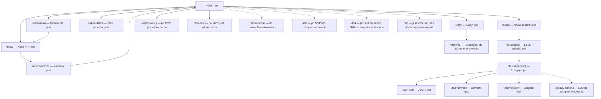
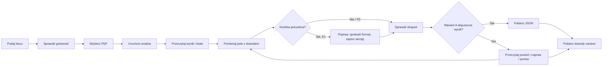
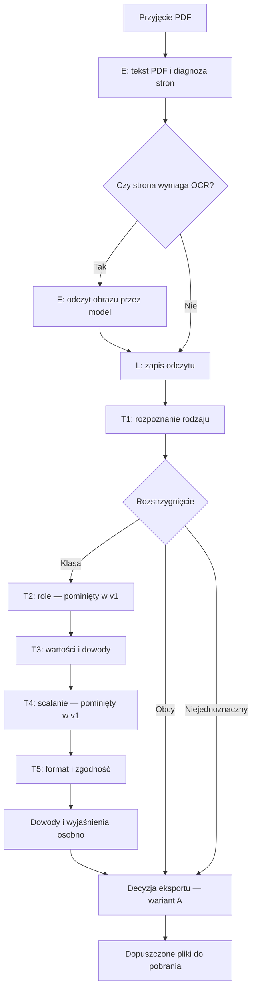
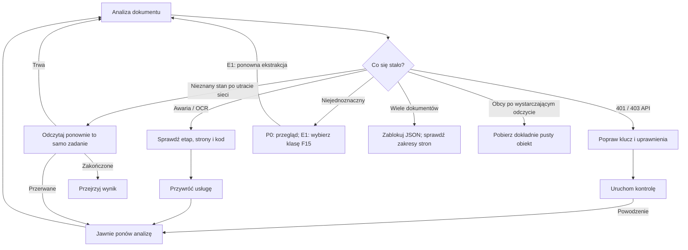
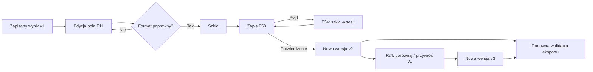

# USER FLOW URZĘDNIKA — od PDF do sprawdzonego wyniku

## 1. Persona, cele, założenia i zakres

Operator to urzędnik przeglądający dokumenty odwołania. Chce ustalić rodzaj dokumentu, sprawdzić odczytane informacje ze źródłem, zrozumieć braki i pobrać właściwy plik. Aplikacja pomaga odczytać dokument; nie rozstrzyga zasadności odwołania i nie zastępuje systemu prowadzenia postępowań KIO.

Podstawa: [zadanie](../../01-zadanie/README.md), [wymagania UZP](../../03-wymagania/README.md), [kontrakt danych](../../03-wymagania/kontrakt-danych.md), [FAQ](../../01-zadanie/zrodla/FAQ-Odwolania2JSON-v1.0.md), [Discord](../../01-zadanie/zrodla/UZP-Discord-doprecyzowania-2026-11-21.md), [odpowiedzi mentora](../../01-zadanie/zrodla/odpowiedzi-mentora-2026-11-21.md), [projekt UI §3, §4, §8 i §9](projekt-ui.md), [architektura wewnętrzna §2–§10](../architektura-wewnetrzna.md), [ADR-002](../../07-decyzje/ADR-002-decyzje-po-recenzji.md), [przepływy techniczne i luki L01–L22](user-flow.md), [pytania otwarte](../../07-decyzje/pytania-otwarte.md). Nazwy F-ID oznaczają ramki projektu, a nie działające funkcje.

Decyzje użytkownika dla tego dokumentu mają pierwszeństwo przed starszymi zapisami:

- Klucz API MiniMax jest obowiązkowy. Model wykonuje OCR i oceny treści; bez klucza i wymaganych kontroli analiza nie rusza. F63 i F64 pozostają w przepływie. Nie jest to logowanie urzędnika.
- Logowanie jest poza zakresem całego tego przepływu. Pomijamy F62, F27 i F50, także w wariancie pełnej aplikacji.
- Eksport stosuje wariant A z ADR-002, uzupełnienie 0.7.0. Awaria oznacza brak pliku wynikowego; tylko potwierdzony dokument obcy daje `{}`. Nie obowiązuje starsze domyślne `empty_json` z architektury §10.
- Wszystkie scenariusze używają danych syntetycznych. Stały baner: „Tryb demonstracyjny. Tylko dane syntetyczne. Bez logowania.” Pełny przebieg opisuje również planowane rozszerzenia; nie zezwala na użycie rzeczywistych akt.
- Jeden PDF to jeden dokument, niezależnie od liczby stron. Pliki są analizowane niezależnie. System nie przenosi informacji między dokumentami tej samej sprawy.

`[PROP]` oznacza propozycję wymagającą decyzji. Nowe teksty i szczegóły komponentu „Przebieg przetwarzania” są propozycją prezentacji danych z istniejących kontraktów; nie dodają wymagań organizatora. Trasy poniżej uwzględniają obecny układ kodu zamiast starszych adresów `/sprawy/...` z projektu UI.

| Etap projektu UI §8 | Co obejmuje przepływ | Reprezentatywne ramki |
|---|---|---|
| P0 — MVP | Desktop 1440×900, PL, jasny motyw; dodanie kilku PDF, analiza, PDF obok danych, odczyt JSON, dowody, jawne braki i błędy, gotowość modeli, YAML poza GUI. Bez korekt i historii użytkowych. | F01–F02, F05–F06, F08, F10, F13–F14, F40–F41, F51–F52, F56–F61 |
| E1 — po MVP | Korekta, zmiana klasy, historia, geometria w interfejsie i diagnoza regionów, odczyt klas, opis procesu, telefon/tablet, EN, motyw ciemny, dostępność i strony 404/500. | F03, F07, F09, F11, F15–F24, F30–F34, F38–F39, F43–F45, F53 |
| E2 — po MVP | Foldery, partie, kolizje ścieżek, ZIP, eksport częściowy, edytor/test/aktywacja zestawu klas. | F28, F36–F37, F42, F46–F48, F54–F55 |
| E3 — po MVP | Użytkownicy i role, audyt, ustawienia retencji, zatwierdzanie i ochrona danych. W tym zleceniu nadal demo; logowanie wyłączone z zakresu. | F12, F25–F26, F29, F35, F49 |

F63–F69 i F06g to późniejsze rozszerzenia ramek: klucz, kontrola, pulpit, dodawanie, galeria. Nie są automatycznym rozszerzeniem całego P0. Geometria dowodu jest wymagana w artefakcie już przez architekturę; brak obrysu w P0 dotyczy sposobu wyświetlania. Stan kodu opisuje §11, nie powyższy plan etapów.

## 2. Mapa nawigacji

Legenda: „jest” oznacza obecność strony w `apps/web/src/app`, z demonstracyjnym źródłem danych; nie potwierdza połączenia z silnikiem. „Do zaimplementowania” oznacza brak odpowiedniej trasy. Adresy błędów są propozycją; istniejące granice 404/500 nie są stronami `/404` i `/500`.

`/sprawy-historia` to wymagane tu miejsce S05; przekazanie identyfikatora dokumentu i wersji pozostaje `[PROP]` (U04). Zakładka „Przegląd” używa `/dokumenty/[id]` lub `?tab=przeglad`. Na telefonie kod ma dodatkowo `?tab=dokument`. Lista jest powrotem z dokumentu; pulpit pozostaje dostępny z nawigacji.

## 3. Przepływ główny krok po kroku

Scenariusz docelowy obejmuje P0 i korektę E1. Dla P0 pomija się kroki 9–10. Teksty przedstawiają oczekiwany interfejs; obecne ograniczenia są jawne w §11.

| Krok | Co robi urzędnik | Co robi system (etap potoku) | Co widzi urzędnik (elementy ekranu, teksty) | Stany i błędy | Ekran (F-ID + trasa) |
|---|---|---|---|---|---|
| 1 | Otwiera aplikację; wybiera „Skonfiguruj klucz”. | Odczytuje stan konfiguracji, bez analizy dokumentu. | Pulpit i baner demo; „Brak klucza API modelu”; analiza zablokowana. | Brak klucza nie jest błędem dokumentu. | F65 → F63, `/` → `/klucz` |
| 2 | Podaje klucz; opcjonalnie zaznacza osobną zgodę na zapis; wybiera „Sprawdź i zapisz”. | Przekazuje sekret do konfiguracji serwera. Domyślnie tylko pamięć, zapis poza Git za zgodą. W aktualnym demo wpisuje wyłącznie fikcyjny klucz. | „Klucz API”, „Pokaż” / „Ukryj”, zgoda domyślnie wyłączona; po przyjęciu „Klucz API skonfigurowany”. | Puste pole: „Podaj klucz API.” Błąd zapisu wymaga ponownego wpisania. | F63, `/klucz` |
| 3 | Wybiera „Sprawdź połączenie”, następnie uruchamia kontrolę. | Sprawdza połączenie, autoryzację, dostępność modelu, metadane regionu/licencji i gotowość OCR. | Lista pięciu kontroli, ich stan i przyczyna; „Sprawdzanie klucza… 3 z 5”, następnie „Klucz przyjęty”. Bez wartości klucza. | 401/403: popraw konfigurację, potem sprawdź ponownie. HTTP samo nie potwierdza licencji ani lokalizacji. | F64/F56, `/klucz/kontrola` |
| 4 | Przechodzi do pulpitu, wybiera „Nowa analiza” i „Wybierz pliki”. | Przyjmuje PDF, sprawdza format, rozmiar i kolizje, ustala jednostki pracy. | „Wybrane pliki ({n})”, nazwy, rozmiary, usuwanie z wyboru, gotowość modelu/OCR i rzeczywisty limit. | Nie-PDF pomijany; przekroczony limit i kolizja wymagają decyzji (§5). | F65/F66/F01/F02, `/dodaj` |
| 5 | Sprawdza listę, wybiera „Uruchom analizę”. | Rejestruje zadanie każdego PDF; rozpoczyna przyjęcie i odczyt E, następnie trwały zapis L. | „Przetworzono {n} z {m} dokumentów”; dla pliku „Przebieg przetwarzania”, lista etapów (§4), czas i stan. | „Oczekuje” → „W toku”. Przycisk startu czeka na potwierdzenie, odświeżenie nie tworzy nowej próby. | F05, `/dodaj`; szczegóły `[PROP]` `/dokumenty/[id]` |
| 6 | Obserwuje postęp; może otworzyć szczegóły odczytu. | Odczytuje tekst PDF, uruchamia OCR wymaganych stron, zapisuje odczyt, rozpoznaje klasę T1, zbiera wartości T3, sprawdza T5. | Nazwa bieżącego etapu; np. „Odczyt obrazu: strona 2 z 4”; rozpoznana klasa i przesłanki, liczba pól, braki i ostrzeżenia. T2/T4 jawnie pominięte w v1. | Niska jakość, brak OCR, konflikt klasy i awaria są rozróżnione; pełna lista w §4–§5. | F05/F23/F57/F58, `/dodaj`, `/dokumenty/[id]` |
| 7 | Otwiera „Dodane dokumenty”, wybiera „Przejrzyj”. | Udostępnia zapisany wynik i raport bez ponownej analizy. | Lista/galeria: nazwa, klasa, stan, braki, źródło tekstu, kody; „Analiza zakończona” nie oznacza powodzenia wszystkich plików. | Pełny, częściowy, obcy, niejednoznaczny albo błąd; „Wiele dokumentów” to ostrzeżenie blokujące eksport. | F06/F06g, `/dokumenty` → `/dokumenty/[id]` |
| 8 | Wybiera pole i „Pokaż dowód”; porównuje ze stroną. | Pokazuje powiązaną stronę, cytat, pochodzenie i metodę; dla wyliczenia regułę i przesłanki. | „Przegląd”, „Wszystkie pola”, „Braki”, „Do sprawdzenia”, „Str. {n}”, „Źródło: tekst PDF” albo „Źródło: OCR”; „Tekst strony” jako alternatywa. | Brak geometrii: brak dokładnego obrysu, „Położenie przybliżone”; brak danych: „Nie przekazano”. | F08/F09/F52/F60, `/dokumenty/[id]` |
| 9 — E1 | Wybiera „Edytuj”, wpisuje wartość z tego samego PDF, „Zastosuj”. | Sprawdza format pola, tworzy szkic, zachowuje wartość silnika i źródło poprawki. | „Szkic — niezapisane zmiany”; błąd powiązany z polem, np. „Numer TED: wpisz numer w formacie 999137-2026.” `[PROP]` | Niepoprawny format blokuje zastosowanie. Poprawka nie staje się automatyczną ekstrakcją. | F11, `/dokumenty/[id]` |
| 10 — E1 | Zapisuje szkic; w razie potrzeby sprawdza historię. | Waliduje cały wynik, tworzy nową trwałą wersję i ponownie sprawdza eksport. | „Zapisywanie…” → „Zapisano v{n}”; wersja silnika i korekta rozdzielone. | F34 zachowuje szkic w sesji, F33 rozstrzyga niezapisane zmiany; §6. | F53/F34/F24, `/dokumenty/[id]`, `/sprawy-historia` (do zaimplementowania) |
| 11 | Otwiera „Eksport”, czyta warunki. | Podejmuje decyzję według wariantu A dla konkretnej zapisanej wersji. | „Eksport dozwolony” albo „Eksport zablokowany”, lista pól i przyczyn; dla obcego „Wynik to dokładnie {}.” | Niedozwolony `null`, awaria, niejednoznaczność, wiele dokumentów: brak ocenianego pliku. | F61, `/dokumenty/[id]?tab=eksport` |
| 12 | Otwiera „JSON”; wybiera „Pobierz JSON”. | Udostępnia kompletny, zwalidowany plik zgodny z kontraktem; nazwa bazowa z PDF. | „Pobierz {nazwa}.json · v{n}” `[PROP]`; po powodzeniu „Pobrano JSON.” Bez dowodów i kodów w tym pliku. | Podgląd roboczy przy blokadzie nie jest dopuszczonym eksportem. Błąd pobrania nie zmienia klasy dokumentu. | F10, `/dokumenty/[id]?tab=json` |
| 13 | Otwiera „Dowody”, wybiera „Pobierz dowody”; opcjonalnie pobiera raport. | Udostępnia osobne materiały istniejące dla tej samej próby i wersji. | Strona, cytat, źródło, metoda, braki, zakres odczytu; „Pobierz dowody (JSON)”. | Przy awarii tylko istniejące materiały; brak dowodów wyjaśniony, bez pliku udającego pełny wynik. | F60, `/dokumenty/[id]?tab=dowody` |

## 4. Czytelny widok przetwarzania

Komponent **„Przebieg przetwarzania”** `[PROP]` jest rozwijaną listą dla każdego dokumentu w F05 oraz w „Przeglądzie”. Pozostaje dostępny po zakończeniu. F05 obecnie pokazuje ogólny postęp dokumentów, nie pełną listę poniżej; ten komponent wymaga implementacji.

Nagłówek pokazuje nazwę PDF, identyfikator próby, początek, czas trwania, ostatnią aktualizację, stan całego zadania oraz bieżący etap. Dalej są uporządkowane wiersze. Każdy ma numer, polską nazwę, ikonę i tekst stanu, licznik pracy, wynik etapu, ostrzeżenia i przycisk „Szczegóły”, jeśli istnieją. W szczegółach: kod z objaśnieniem, strona/pole, przyczyna, wykonana kontrola i możliwa akcja. Nie pokazujemy sekretu ani surowego błędu programistycznego.

Wspólne stany wiersza: „Oczekuje” — jeszcze nie rozpoczęto; „W toku” — trwa praca; „Zakończony” — etap skończył się, może zawierać ostrzeżenia; „Pominięty” — etap niewymagany lub zablokowany z podanym powodem; „Błąd” — etap nie wykonał swojej pracy. W tabeli: O = oczekuje, W = w toku, Z = zakończony, P = pominięty, B = błąd. To stany prezentacji etapów, nie nowe wyniki API.

| Wiersz i etap architektury | Stany | Co system robi i co pokazuje po zakończeniu | Kiedy pomija / jak pokazuje błąd |
|---|---|---|---|
| 1. „Przyjęcie pliku” — rejestracja | O/W/Z/B | Sprawdza plik, utrwala wejście i ścieżkę; nazwa, rozmiar, liczba stron, jeśli już ustalona, identyfikator próby. | Nie-PDF i limit: odrzucenie przed analizą. Uszkodzony/zaszyfrowany PDF: konkretna przyczyna, nie „obcy”. |
| 2. „Odczyt tekstu PDF” — E | O/W/Z/P/B | Odczytuje strony, tekst i położenie słów. Pokazuje „Odczytano {n} z {m} stron”, strony tekstowe, mieszane, skanowane i nierozpoznane; „OCR potrzebny na stronach: {lista}”. | P po odrzuceniu wejścia. B przy awarii odczytu; zachowuje faktyczny zakres. Brak tekstu na skanie jest diagnozą, nie automatycznie awarią całego pliku. |
| 3. „Odczyt obrazu (OCR)” — E | O/W/Z/P/B | Model odczytuje obrazy wymaganych stron; liczba stron odczytanych i nieprzetworzonych, źródło tekstu i ostrzeżenia jakości. „OCR tymczasowy (shim): {nazwa}, {wersja}”, tylko gdy rzeczywiście użyto zamiennika. | P: „Nie wymaga OCR” albo „Nie rozpoczęto — błąd przyjęcia”. Niedostępna usługa: B, lista dotkniętych stron, kod i dalsza możliwość wyniku częściowego. |
| 4. „Zapis odczytu” — L | O/W/Z/P/B | Zachowuje odczyt, obrazy i diagnozy, aby dalsze sprawdzanie nie wymagało powtórzenia OCR; „Odczyt zapisany: {n} stron”. | B: `zapis_nieudany` — „Nie udało się zapisać odczytu”. Kolejne etapy P; nie pracują na niedokończonym zapisie. |
| 5. „Rozpoznanie rodzaju dokumentu” — T1 | O/W/Z/P/B | Rozpoznaje po funkcji treści: wniesienie odwołania / udzielenie pełnomocnictwa / wykonana płatność. Pokazuje klasę, przesłanki za i przeciw, dostępne cytaty, wersję zestawu klas i ostrzeżenie wielu dokumentów. | Obcy i niejednoznaczny: Z z takim rozstrzygnięciem, nie B. Brak dostatecznego odczytu lub awaria modelu: jawne ograniczenie/błąd; nie wybiera „obcy”. |
| 6. „Ustalenie osób i ich ról” — T2, rozszerzenie | O/W/Z/P/B | Łączy osoby i podmioty z rolami; liczba rozpoznanych grup i konfliktów, np. „Nie ustalono, komu udzielono pełnomocnictwa”. | W v1 P: „Osobny etap wyłączony w tej wersji; role odczytywane razem z polami”. Włączenie dopiero po pomiarze jakości. |
| 7. „Odczyt informacji do pól” — T3 | O/W/Z/P/B | Zbiera wartości z całego dokumentu, wiąże z cytatami; „Wartości w {n} z {m} pól”, liczba pustych i wymagających sprawdzenia. | P po obcym, niejednoznacznym lub wcześniejszym błędzie. B: brak/poprawność odpowiedzi modelu z objaśnieniem; bez wymyślania pól. |
| 8. „Porównanie informacji i zakresu odczytu” — T4, rozszerzenie | O/W/Z/P/B | Porównuje powtórzenia, wykazuje sprzeczności i nieprzetworzone zakresy; liczba konfliktów, braków i wykorzystanych prób uzupełnienia. | W v1 P: „Osobny etap wyłączony w tej wersji”; podstawowe sprawdzenie braków nadal działa. Rozszerzenie ma ograniczoną liczbę prób, bez obietnicy automatycznej naprawy. |
| 9. „Sprawdzenie i ujednolicenie danych” — T5 | O/W/Z/P/B | Sprawdza klucze, typy, daty, liczby i słowniki, zachowuje numery identyfikacyjne jako tekst. Pokazuje liczbę poprawnych pól, błędy ze ścieżkami i dopuszczalność `null`. | Z może wskazywać „Wynik niezgodny ze schematem” i blokadę eksportu. B to awaria samego sprawdzenia. Obcy: P — nie ma pól danej klasy. |
| 10. „Przygotowanie dowodów i wyjaśnień” — kotwiczenie T3 + eksport | O/W/Z/P/B | Zbiera dowody już sprawdzane podczas T3: strona, cytat, położenie, źródło, metoda, przesłanki wyliczeń; „Dowody: {n}; pola bez potwierdzonego dowodu: {m}”. Raportuje pięć powodów braków. | Nie jest dodatkowym wywołaniem modelu. Brak geometrii nie tworzy fikcyjnego obrysu. Jeśli nic nie powstało: P z powodem; raport awarii może pozostać dostępny. |
| 11. „Sprawdzenie możliwości pobrania” — eksport | O/W/Z/P/B | Stosuje wariant A; „Eksport dozwolony” lub „Eksport zablokowany: {powody}”; wskazuje konkretną zapisaną wersję. | Blokada polityką to Z z decyzją odmowną, nie awaria sprawdzania. Awaria sprawdzania: B i pobranie zablokowane. |
| 12. „Przygotowanie plików do pobrania” — eksport | O/W/Z/P/B | Udostępnia kompletnie zapisany JSON, osobne dowody i raport; nazwy i wersja. Pobranie przez urzędnika jest osobną czynnością. | Oceniany JSON P przy blokadzie; istniejące dowody/raport nadal dostępne. B zapisu nie publikuje niekompletnego pliku. |

Wiersze 2–3 należą do jednego etapu E; dowody powstają już przy zbieraniu wartości. T1 i T3 w v1 korzystają ze wspólnej odpowiedzi AI: pokazane nazwy opisują pracę, nie liczbę zapytań. Dla obcego T3/T5 są pominięte, a etap eksportu przygotowuje `{}`. Po awarii zależne wiersze są pominięte z przyczyną; wiersze raportu i decyzji pobrania mogą się zakończyć.

Postęp nie jest oceną poprawności: „Przetworzono 3 z 4” liczy zakończone dokumenty, także z błędem. Licznik stron OCR dotyczy stron, a licznik pól — pól. `[PROP]` Gdy nie znamy czasu lub liczby jednostek, pokazujemy „W toku” i czas dotychczasowy zamiast wymyślonego procentu. Stan „Oczekuje” nie jest zawieszeniem programu. Widok ostatniej aktualizacji po utracie sieci mówi „Stan może być nieaktualny”.

F23 (E1) rozwija diagnozę: „Dokument”, „Strona”, „Region”. Urzędnik wybiera np. stronę 2, region R3; widzi tekst/obraz, obrót 90° → 0°, źródło tekstu, pokrycie odczytem, jakość, sygnały i kod `zla_warstwa_ocr` — „Warstwa rozpoznanego tekstu może nie odpowiadać obrazowi”. Nieznane wartości: „Nie przekazano”. Brak analizy regionów w v1: „Diagnoza dostępna na poziomie strony” `[PROP]`; nie tworzymy sztucznych regionów. Pewność odczytu i ocena klasy nie są odsetkiem poprawnych danych.

| Pytanie urzędnika | Wyjaśnienie widoczne w przeglądzie |
|---|---|
| Dlaczego częściowy? | Lista konkretnych pól, pięć powodów z §5, strony sprawdzone i nieprzetworzone, ostrzeżenia oraz osobna decyzja eksportu. Uzasadniony dopuszczalny `null` sam nie wymusza częściowości. |
| Dlaczego obcy? | „Odczytano treść, lecz nie odpowiada żadnej aktywnej klasie”; lista klas i przesłanki, np. funkcja rozstrzygnięcia zamiast wniesienia odwołania. `dokument_obcy` — „Dokument spoza obsługiwanych rodzajów”. |
| Dlaczego niejednoznaczny? | Konkurujące rodzaje i przesłanki za/przeciw, jeśli przekazane. `klasa_niejednoznaczna` — „Treść nie pozwala wybrać jednego rodzaju”; w P0 prosty baner, szczegóły i wybór F15 w E1. |
| Dlaczego nie ma pliku? | Lista blokad wariantu A, etap i kod z objaśnieniem; brak odczytu nie jest przesłanką obcego. `walidacja_wyniku_nieudana` — „Wynik nie spełnia wymaganego formatu”. |

## 5. Ścieżki wyjątkowe i naprawcze

Teksty opisują właściwą przyczynę, nie sam kod. Kody katalogu są z [katalogu kodów](../../05-weryfikacja/katalog-kodow.md); angielskie odpowiedniki architektury pozostają propozycją mapowania. HTTP 403 usługi MiniMax to odmowa API, a strona 403 aplikacji oznacza brak dostępu do ekranu w E3.

| Wyzwalacz | Komunikat PL i kod z objaśnieniem | Akcje urzędnika | Wynik | Ekran / trasa |
|---|---|---|---|---|
| Awaria modelu, odczytu lub przekroczony czas | „Nie udało się przetworzyć dokumentu. Etap: {etap}. {przyczyna}.” `llm_niedostepny` — usługa modelu nie odpowiada; `limit_czasu` — przekroczono czas tej próby. | Sprawdza diagnozę, po usunięciu przyczyny „Ponów analizę”. | Nowa jawna próba; pozostałe pliki kontynuowane. Bez pliku zastępczego i bez starego wyniku udającego nowy. | F14/F06, `/dokumenty/[id]`, `/dokumenty` |
| Brak klucza, HTTP 401/403 | „Brak klucza API modelu”, „API odrzuciło uwierzytelnienie (401)” / „API odmówiło dostępu (403). Sprawdź uprawnienia klucza.” `llm_autoryzacja` — model nie dopuścił wywołania. | Poprawia klucz/configurację, uruchamia kontrolę, potem osobno ponawia dokument. | Bez automatycznych powtórzeń 401/403. Sam zapis klucza nie ponawia ekstrakcji. Bez klucza brak analizy także tekstowego PDF. | F63/F64/F56/F14, `/klucz`, `/klucz/kontrola` |
| OCR niedostępny albo błąd OCR | „OCR niedostępny. Strony wymagające OCR pozostaną nieprzetworzone.” `ocr_niedostepny` / `ocr_blad` — obrazu nie odczytano. | Sprawdza listę stron, przywraca usługę lub prosi konfigurującego o pomoc; kontrola, potem „Ponów analizę”. | Przy działającym wymaganym modelu i dostępnej części tekstu możliwy jawny wynik częściowy; bez podstaw błąd techniczny. Bez klucza MiniMax brak trybu obejścia. | F57/F23/F51/F14, `/dokumenty/[id]`, `/klucz/kontrola` |
| Użyto zastępczego OCR | „OCR tymczasowy (shim): {komponent}, {wersja}”. | Porównuje odczyt ze skanem i dowodem. | Wynik opisuje rzeczywiście użyty komponent; nie deklaruje podłączenia własnego modelu. Dostępność zamiennika nie usuwa obowiązku klucza MiniMax. | F58/F56, `/jak-to-dziala`, `/dokumenty/[id]` |
| Czytelny dokument nie pasuje do klas | „Dokument spoza zakresu”; `dokument_obcy` — treść spoza trzech aktywnych rodzajów. | Czyta „Dlaczego?”, ogląda źródło, pobiera `{nazwa}.json`. | Dokładnie `{}`; nie jest to awaria. | F13/F10, `/dokumenty/[id]` |
| Konflikt rozpoznania klasy | „Nie ustalono jednoznacznie klasy dokumentu. Wymaga przeglądu.” `klasa_niejednoznaczna`. | P0: przegląda i wraca, bez wymuszania klasy. E1: F15, wybiera rodzaj z aktywnych klas, „Zmień i wyodrębnij ponownie”. | JSON zablokowany do nowego rozstrzygnięcia i walidacji; wybór nie tylko zmienia etykietę. | F40/F15, `/dokumenty/[id]` |
| Różne dokumenty połączone w jeden PDF | „Wykryto wiele dokumentów w jednym PDF. Sprawdź podział.” `wiele_dokumentow`. | Sprawdza zakresy stron; `[PROP]` poza aplikacją przygotowuje osobne syntetyczne PDF i dodaje jako nowe wejścia. | Wariant A blokuje ten PDF. Bez scalania pól, eksportu pierwszego segmentu i tablicy wyników. Nadal jeden PDF = jedna jednostka. | F41, `/dokumenty/[id]` |
| Wynik częściowy | „Wynik częściowy. Sprawdź listę braków ({n}).” | Filtruje „Braki”, sprawdza przyczynę z tabeli poniżej; w E1 koryguje z własnego PDF lub po naprawie ponawia. | JSON tylko gdy schemat dopuszcza wszystkie wartości i `null` oraz spełniono wymagania dowodów. | F51/F61, `/dokumenty/[id]` |
| Wybrano nie-PDF | „{nazwa}: to nie jest PDF — pominięto.” | Wybiera właściwy PDF; uruchamia pozostałe dopuszczone pliki. | Bez zadania ekstrakcji dla nie-PDF; bez klasy „obcy”. Kod odrzucenia nie jest ustalony w projekcie. | F01/F02/F66, `/dodaj` |
| Ta sama ścieżka, inne bajty lub kolizja nazw wynikowych | „Kolizja ścieżki {ścieżka}. Wybierz nową wersję dokumentu, osobną paczkę albo anuluj”. | P0 usuwa konflikt z wyboru / osobna paczka; E2 wybiera nową wersję, osobną paczkę lub anuluje. | Brak nadpisania i automatycznego dopisku `(2)`; eksportuje jedną zapisaną wersję na ścieżkę. | F54, `/dodaj`, `/dokumenty` |
| Eksport/wyjście przy niezapisanym szkicu | „Masz niezapisane zmiany” `[PROP]`; informacja o wersji zapisanej i szkicu. | „Zapisz i kontynuuj”, „Odrzuć zmiany i kontynuuj”, „Zostań” `[PROP]`. | Zamierzona akcja dopiero po rozstrzygnięciu. Szkic nie jest plikiem wynikowym. | F33, `/dokumenty/[id]` |
| Trwa zapis / zapis się nie udał | „Zapisywanie…” / „Nie zapisano. Szkic zachowano w tej sesji”; `zapis_nieudany` — trwały zapis niepotwierdzony. | Czeka; przy błędzie „Ponów zapis” albo pozostaje przy szkicu. | Eksport wstrzymany; dopiero potwierdzona wersja jest dostępna. Nie obiecujemy odzyskania po restarcie. | F53/F34, `/dokumenty/[id]` |
| Plik/partia przekracza skonfigurowany limit | „{nazwa}: plik przekracza limit {limit_mb} MB” `[PROP]`. Przy braku ustawienia: „Nie określono limitu plików. Analiza zablokowana” `[PROP]`. | Usuwa plik, wybiera mniejszy lub prosi konfigurującego o sprawdzenie limitu; nie tnie dokumentu po cichu. | Limit pochodzi z konfiguracji; brak wymyślonej liczby i limitu stron. Limity czasu/kontekstu pokazują nieprzetworzone zakresy. | F02/F56, `/dodaj` |
| Utrata połączenia przeglądarki w trakcie | „Nie udało się połączyć z serwerem. Sprawdź połączenie i spróbuj ponownie.” | „Spróbuj ponownie” odczytuje stan istniejącego zadania. | Utrata podglądu nie dowodzi zatrzymania analizy. Po restarcie serwera przerwana próba ma jawny błąd; ponowienie analizy jest osobne. | F05/F14, `/dodaj`, `/dokumenty/[id]` |
| Limit API 429 / brak budżetu | „Osiągnięto limit zapytań. Ponów po {czas_z_API}” albo „Brak dostępnych środków API”. | Czeka zgodnie z odpowiedzią lub uzupełnia budżet poza GUI, potem ponawia. | Ograniczony budżet prób; bez wymyślonego czasu oczekiwania, gdy API go nie podało. | F56/F14/F64, `/klucz/kontrola`, `/dokumenty/[id]` |

Pięć powodów pustego pola z architektury (§4.6); powód pozostaje poza ocenianym JSON:

| Powód | Tekst przy polu | Naprawa / interpretacja |
|---|---|---|
| Brak | „Nie znaleziono informacji. Sprawdzone strony: {lista}.” | Sprawdź wskazane strony; nie uzupełniaj informacją z innego pliku. |
| Nie dotyczy | „Nie dotyczy: {reguła i przesłanki}.” | Sprawdź zasadę; `null` może być prawidłowy i nie wymaga zgadywania. |
| Nieczytelne | „Treść jest obecna, ale nie można jej odczytać.” | Porównaj obraz, popraw źródło albo odczyt; w E1 wpisz tylko odczytaną wartość. |
| Sprzeczne | „Znaleziono sprzeczne wartości. Porównaj dowody.” | Porównaj wszystkie wskazane fragmenty; w E1 rozstrzygnij z uzasadnieniem `[PROP]`. |
| Nieprzetworzone | „Nie przetworzono stron/regionów: {lista}.” | Napraw OCR lub przyczynę limitu, ponów; nie jest to potwierdzony brak informacji. |

„Do sprawdzenia” jest dodatkowym oznaczeniem, także dla obecnej wartości. Nie zastępuje pięciu powodów i nie zamienia automatycznie wartości na `null`.

## 6. Korekta i wersjonowanie

Korekta jest E1. Urzędnik najpierw wybiera pole i dowód, potem „Edytuj”. F11 sprawdza format, np. datę i numer TED. Komunikat obok pola wyjaśnia oczekiwany zapis; „Zastosuj” pozostaje zablokowane przy błędzie. Poprawny format nie potwierdza zgodności z treścią. Identyfikatory, PESEL i rachunki pozostają tekstem; kwota liczbą zgodnie z referencją.

Zastosowanie zmienia szkic. „Zapisz zmiany” tworzy nową wersję wyniku po walidacji całego dokumentu; F53 pokazuje oczekiwanie na potwierdzenie. System zachowuje oryginalny PDF, wynik silnika, poprawioną wartość i informację, że pochodzi od operatora. `[PROP]` Przy poprawce wskazuje się stronę i fragment uzasadniający zmianę; nie przypisuje się starego cytatu do nowej wartości bez kontroli. Historia kont użytkowników nie jest obiecywana w demo bez logowania.

F33 rozstrzyga szkic przed zmianą dokumentu, klasy, wersji lub eksportem. F34 zachowuje niezapisany szkic tylko w bieżącej sesji. Nieudany zapis nie tworzy nowej wersji; eksport nie może omyłkowo pobrać szkicu ani udawać zapisu. Propozycje etykiet trzech akcji są w §5.

S05/F24 pokazuje osobno wersję dokumentu i wyniku: v1 „silnik”, v2 „korekta”, kolejne „ponowna analiza” / „przywrócenie”. Porównanie „Było” / „Jest” obejmuje wartość i pochodzenie. „Przywróć v1” tworzy kolejną wersję, nie usuwa historii. `[PROP]` Eksport domyślnie używa bieżącej zapisanej wersji; świadomy wybór wcześniejszej jest opisany jej numerem i przechodzi wariant A. Zatwierdzenie przez drugą osobę jest propozycją E3, nie warunkiem P0 ani synonimem poprawności ekstrakcji.

Obecny `DocumentField` zapisuje pojedyncze pole do demonstracyjnego klienta. To nie realizuje powyższego kontraktu szkicu, atomowego zapisu wersji i historii. Zmiana klasy w mocku również nie dowodzi ponownej ekstrakcji.

## 7. Praca z wieloma dokumentami

Urzędnik wybiera listę F06 albo galerię F06g w `/dokumenty`. Każdy wpis pokazuje nazwę, klasę, stan, źródło tekstu, liczbę braków i ostrzeżenia. Filtry: status (F67), klasa, źródło, kody i „Wymaga uwagi”; sortowanie (F68) i wyszukiwanie; pusty wynik F69: „Brak dokumentów pasujących do wyszukiwania.” `[PROP]` Powrót z dokumentu zachowuje filtry i widok. Automatyczna galeria od 7 plików pozostaje propozycją L08, nie ustaloną zasadą; ręczny wybór ma być dostępny. Brak projektu masowego zaznaczania — nie zakładamy go.

„Ponów nieudane” dotyczy wyłącznie nieudanych dokumentów po usunięciu przyczyny. Gotowe wyniki pozostają do odczytu. Nie ma wspólnego uzupełniania danych pomiędzy plikami. Sprawa i partia porządkują pracę, nie są dodatkowym źródłem treści dla modelu.

E2/F28: foldery, filtr partii, grupa „Katalog główny”, zachowane głębokie ścieżki. `input/sprawa/zalaczniki/a.pdf` daje `output/sprawa/zalaczniki/a.json`. Osobno `evidence/` z tym samym drzewem. Kolizja F54 jest rozstrzygana przed analizą lub wspólnym eksportem; wersja wyniku nie zmienia oryginalnej ścieżki.

F42 przed „Pobierz wyniki partii (ZIP)” pokazuje dwie listy i liczniki:

- „Uwzględnione”: pełne, częściowe zgodne ze schematem i potwierdzone obce (`{}`).
- „Pominięte”: awaria, niejednoznaczność, wiele dokumentów, niedozwolony `null` lub inna niezgodność; każda pozycja ze ścieżką i powodem. Przyszła odmowa dostępu także wyklucza plik.

Akcje: „Pobierz {n} wyników”, „Pobierz dowody partii”, osobny raport pominięć i „Wróć”. Przy n=0: „Brak wyników do pobrania”; brak pustego ZIP udającego sukces. Raport nie trafia do `output/`. Nie dodajemy `{}` dla pominiętych awarii. E2 oraz pełny kontrakt ZIP pozostają do implementacji; obecna galeria nie potwierdza ich działania.

## 8. Administracja i konfiguracja

Operator odczytuje aktywną wersję klas, modelu i OCR w F56; ustawienia `/ustawienia` prowadzą do konfiguracji klucza i kontroli. Kontrola ujawnia wszystkie użyte modele, największy model, wersje, licencje i region. Przycisk „Sprawdź ponownie” ma odróżniać odczyt ostatniego stanu od nowej kontroli usługi `[PROP]`. Nie jest ponowną analizą dokumentu. Poprawne połączenie nie jest potwierdzeniem zgodności licencji. Zatwierdzone metadane i decyzje zespołu trzeba odróżniać od symulacji.

P0/F59: osoba konfigurująca, poza GUI, dodaje demonstracyjną klasę „Nota testowa” z `numer_noty`, przeładowuje kompletny YAML (restart dozwolony), a urzędnik analizuje syntetyczny PDF i porównuje formularz, JSON i dowód. Następnie konfigurujący dodaje `oznaczenie_sprawy` jako kolejną wersję; nowa analiza musi naprawdę odczytać oba pola. Na końcu przywraca oficjalny zestaw. Sam pokaz formularza nie dowodzi rozbudowy ekstrakcji. Nie modyfikuje się oryginałów organizatora.

E1/F20–F21: `/klasy` i `/klasy/[id]` służą do odczytu pól i YAML; szczegóły w kodzie są obecnie rozwijane na liście, bez osobnej trasy. E2/F36–F37: edycja, test, walidacja i aktywacja kompletnego zestawu. F47–F48–F55: „Aktywowanie…” → „Zestaw v2 aktywny” albo „Nie aktywowano. Nadal aktywny v1. Ponów”. Błędny zestaw nie zastępuje poprzedniego; gdy nie ma poprawnego zestawu, F46 blokuje analizę. Trwające i historyczne zadania zachowują przypięte wersje. Przeładowanie bez restartu pozostaje pytaniem.

E3/F25 `/uzytkownicy`: plan zarządzania syntetycznymi użytkownikami i rolami; F26 `/dziennik`: plan przeglądu zdarzeń, filtrów i CSV. Widoki demo istnieją, lecz nie stanowią kontroli uprawnień ani trwałego audytu. F29 `/ustawienia` obejmuje plan retencji i walidacji liczby dni; preferencje języka/motywu należą do E1. Retencja, izolacja i usuwanie sesji wymagają realizacji przed udostępnieniem demo na serwerze. Logowanie pominięte zgodnie z zakresem, bez dodawania przepływu kont.

## 9. Dostępność i responsywność w przepływie

P0: cały krytyczny przebieg klawiaturą, „Przejdź do treści”, widoczny fokus, etykiety przycisków, komunikat walidacji powiązany z polem, status tekstowy z ikoną. Zmiany postępu i zapisu są odczytywane przez czytnik ekranu; błąd krytyczny jest ogłaszany od razu. Okno trzyma fokus i po zamknięciu oddaje go do przycisku, który je otworzył. „Tekst strony” umożliwia przeczytanie odczytu bez polegania na obrysie PDF. Kod i kolor zawsze mają tekstowe objaśnienie.

E1: F03 — wybór PDF na telefonie, F07 — karty wyników, F18 — dane pionowo, F19 — dowód i „Wróć do pola {nazwa}”. Zakładki dokument/dane/JSON oraz „Więcej” udostępniają pozostałe treści. Galeria telefonu nie ma odrębnej ramki; potrzebuje projektu, nie samego pomniejszenia desktopu. F16/F17 obejmują szerokości pośrednie i tablet.

F44/F45: reflow przy 320 CSS px, zawijane nazwy, kody i komunikaty, tabele jako karty; strona bez poziomego przewijania. PDF i kod mogą przewijać się wewnątrz panelu, tekst alternatywny pozostaje zawijany. Sprawdzenie obejmuje także powiększenie 400%, tekst 200%, klawiaturę ekranową i widoczność ostatniej akcji. To kryteria odbioru, nie wynik audytu.

Motyw jasny to P0; ciemny/systemowy E1 (F65d to propozycja). PDF zachowuje białą stronę, obrys musi być czytelny w obu motywach. EN/F43 tłumaczy interfejs; klucze JSON, wartości i cytaty zachowują postać źródła. Dokument opisuje teksty PL; nie uznaje widocznego przełącznika za pełne tłumaczenie. W `/dostepnosc` (do zaimplementowania) ma być „Nie przeprowadzono audytu”, znane ograniczenia PDF/OCR i rzeczywisty kontakt z konfiguracji. W P0 ta informacja jest dostępna z dodawania/przeglądu. Strony 404/500 mają akcję powrotu i ponowienia odczytu; E3/403 nie ujawnia treści dokumentu.

## 10. Tablica zgodności

Status ocenia **pokrycie w zaprojektowanym przepływie operatora**, nie realizację wymagania przez produkt. „Pokryte” = krok i rezultat opisane; „częściowo” = opis jest, ale wymaga rozstrzygnięcia/odbioru; „luka” = ten przepływ GUI nie dostarcza dowodu spełnienia. Stan implementacji jest osobno w §11. Źródło numerów: [wymagania](../../03-wymagania/README.md); cytaty uzupełniające: [punktacja i transparentność](../../01-zadanie/punktacja.md).

| Wymaganie zadania/organizatora | Krok przepływu | Ekran/trasa | Status pokrycia i ograniczenie |
|---|---|---|---|
| UZP-01 — trzy klasy i automatyczna klasyfikacja | 6–8, §4 | F05/F08/F13, `/dokumenty/[id]` | pokryte — funkcja treści i uzasadnienie, nazwa pliku nie rozstrzyga |
| UZP-02 — tekst, skany, mieszane (uzupełnienie 0.5.0) | 3, 6, §4–§5 | F56–F58/F23/F52 | częściowo — diagnoza i naprawa opisane; działający OCR/model i dowody wymagają odbioru |
| UZP-03 — ścisły JSON, dowody osobno | 11–13 | F10/F60/F61, `?tab=json/dowody/eksport` | pokryte — wariant A i rozdzielenie plików; zapis skrócony oznacza trzy osobne wartości `tab` |
| UZP-04 — brak zmyślonych danych | 8–11, §5 | F51/F11/F61 | częściowo — pięć powodów i blokada; U-Q13 o nieczytelnym wymaganym polu nadal otwarte |
| UZP-05 — Python 3.13+, requirements.txt, tylko pip, CLI | przed krokiem 1 | poza GUI; F56 pokazuje wersje | luka — dokument operatora nie zastępuje próby instalacji i CLI; U11 |
| UZP-06 — nazwy i podfoldery input/output | 4, 12, §7 | F28/F42/F54, `/dokumenty` | częściowo — pojedyncze nazwy opisane; foldery i ZIP dopiero E2, niepotwierdzone testem |
| UZP-07 — obcy: pusty JSON z nazwą oryginału; mentor: dokładnie `{}` | 7, 11–12, §5 | F13/F10 | pokryte — wystarczający odczyt, przesłanki i dokładna reprezentacja |
| UZP-08 — otwarte komponenty i model możliwy do instalacji lokalnej | 3, §8 | F56/F22, `/jak-to-dziala` | luka — karta metadanych i udana kontrola nie dowodzą licencji ani możliwości lokalnej instalacji; U10 |
| UZP-09 — API darmowe, płatne lub własne | 2–3, §8 | F63/F64/F56 | pokryte — wymagany MiniMax przez API, odrębna konfiguracja i kontrola |
| UZP-10 — dostawca/serwer w wymaganym regionie; mentor: Europa | 3, §8 | F56/F64 | częściowo — decyzja zespołu o Europie w ADR zamknięta; weryfikowalne metadane odróżnione od symulacji |
| UZP-11 — laptop bez GPU, model przez publiczne API | 3, 5–6 | F56/F05 | luka — przepływ nie potwierdza pracy wydanego pakietu na laptopie jury ani publicznej dostępności; U11 |
| UZP-12 — klucz płatnego API dla jury, poza Git | 1–3, §5 | F63/F64 | częściowo — konfiguracja opisana, U-Q04: kanał, budżet i czas dostępu nieuzgodnione |
| UZP-13 — brak ogłoszonego limitu czasu testu | 5–6, §4–§5 | F05/F14 | pokryte — czas dotychczasowy i jawny limit zasobowy, bez wymyślonego czasu jury |
| UZP-14 — klasy i pola konfiguracją | §8, potem 4–13 | F59/F20/F21/F36/F37 | częściowo — rzeczywista ekstrakcja po zmianie YAML wymaga odbioru; sam formularz nie wystarcza |
| UZP-15 — PDF i JSON obok siebie, GUI obowiązkowe z decyzji zespołu | 4–13 | F08/F10/F60, `/dodaj`, `/dokumenty/[id]` | częściowo — kod pokazuje syntetyczną stronę, brak potwierdzonego oryginalnego PDF |
| README §5 — „wspierające transparentność procesu ekstrakcji danych” | 5–8, 13, §4 | F05/F23/F51/F60 | częściowo — kompletna lista etapów, diagnoza i pochodzenie wymagają połączenia z silnikiem |

W tablicy są **3 luki**: UZP-05, UZP-08, UZP-11. Nie są ukryte w częściowym pokryciu. Osobno 8 wierszy ma status „częściowo”; nawet „pokryte” nie oznacza potwierdzonej implementacji ani F1.

## 11. Mapa F-ID → trasa → stan implementacji

Inwentarz z 2026-11-21: `ls apps/web/design/`, `find apps/web/src/app -name page.tsx` oraz odczyt `document.json` z [pliku FigCraft](figcraft/odwolania2json-ui.figcraft). „Tak” w kolumnie makiet oznacza ramkę w tym lokalnym pliku i PNG w katalogu design; nie potwierdza stanu usługi FigCraft. „Nie” oznacza pozycję opisaną tylko w projekcie UI. Nie przeglądano zewnętrznej tablicy.

Kod: `apps/web/src/lib/api/index.ts` wybiera klient demonstracyjny; `DocumentPreview` rysuje syntetyczną stronę, a `DropZone` przekazuje metadane pliku. Kontrola klucza jest symulacją, nie wywołaniem MiniMax. `BatchProgress` liczy zakończone dokumenty, nie etapy E/L/T. `DocumentView` ma zakładki, pobrania i blokadę eksportu; `DocumentField` ma prostą edycję. Testy `lib/api/mock/client.test.ts` opisują wariant A, 401 i wybór klasy wyłącznie dla mocka; obecność tych testów nie oznacza ich uruchomienia w tej zmianie. Nie uruchamiano ani nie oceniano aplikacji w przeglądarce.

Legenda kodu w tabeli: **demo** — istnieje strona/komponent z danymi demonstracyjnymi; **częściowo** — trasa istnieje, ale wskazany wariant wymaga dalszej implementacji; **brak** — do zaimplementowania. Żaden wpis „demo” nie oznacza gotowej analizy PDF. Wszystkie trasy dokumentu poniżej oznaczają `/dokumenty/[id]`, nie konkretny istniejący identyfikator.

| F-ID i widok | FigCraft + PNG | Trasa / miejsce | Stan implementacji wskazanego widoku |
|---|---|---|---|
| F00 — komponenty | Tak | komponenty wspólne, bez trasy | częściowo — to plansza projektu, nie strona aplikacji |
| F01 — pusty wybór | Tak | `/dodaj` | demo |
| F02 — wybrane pliki | Tak | `/dodaj` | demo — brak rzeczywistego przesłania bajtów PDF |
| F03 — wybór telefon | Tak | `/dodaj` | demo — układ responsywny; bez odbioru na urządzeniu |
| F04 — menu telefonu | Nie | powłoka wszystkich stron | częściowo — menu w powłoce; brak tej ramki i odbioru wariantu |
| F05 — analiza w toku | Tak | `/dodaj` | częściowo — licznik dokumentów; brak pełnej listy etapów |
| F06 — lista wyników | Tak | `/dokumenty`, podsumowanie w `/dodaj` | demo |
| F06g — galeria | Tak | `/dokumenty` | demo |
| F07 — wyniki telefon | Nie | `/dodaj`, `/dokumenty` | częściowo — są karty responsywne; brak tej ramki |
| F08 — przegląd z dowodem | Tak | `/dokumenty/[id]` | demo — strona syntetyczna zamiast oryginału PDF |
| F09 — dowód geometryczny | Nie | `/dokumenty/[id]` | częściowo — obrysy z danych demo; brak potwierdzenia geometrii silnika |
| F10 — JSON | Tak | `/dokumenty/[id]?tab=json` | demo — pobranie z mocka, bez walidacji pełnego kontraktu silnika |
| F11 — walidacja korekty | Nie | `/dokumenty/[id]` | częściowo — prosty zapis pola; brak pełnego szkicu i wersji |
| F12 — chroniony skan | Nie | `/dokumenty/[id]` | brak — bezpieczna pochodna i ochrona E3 do zaimplementowania |
| F13 — obcy | Tak | `/dokumenty/[id]` | demo — `{}` dla stanu danych demo |
| F14 — błąd techniczny | Tak | `/dokumenty/[id]` | demo — stan i ponowienie symulowane |
| F15 — zmiana klasy | Nie | `/dokumenty/[id]` | częściowo — wybór w widoku wyjątku; brak dialogu i rzeczywistej ponownej ekstrakcji |
| F16 — układ pośredni | Nie | `/dokumenty/[id]` | częściowo — style responsywne, wariant do odbioru |
| F17 — tablet | Nie | `/dokumenty/[id]` | częściowo — style responsywne, wariant do odbioru |
| F18 — telefon dane | Tak | `/dokumenty/[id]` | demo — wariant wymaga odbioru dostępności |
| F19 — telefon dowód | Nie | `/dokumenty/[id]?tab=dokument` | częściowo — link do dokumentu; powrót/fokus i zachowanie wyboru wymagają odbioru |
| F20 — klasy | Tak | `/klasy` | demo — szczegóły pól rozwijane na liście |
| F21 — YAML odczyt | Nie | `/klasy/[id]` | brak — do zaimplementowania; lista pól nie zastępuje odczytu YAML |
| F22 — opis procesu | Tak | `/jak-to-dziala` | demo — opis i metadane demonstracyjne |
| F23 — diagnoza regionów | Nie | `/dokumenty/[id]` | brak — pełny panel dokument/strona/region do zaimplementowania |
| F24 — historia S05 | Nie | `/sprawy-historia` | brak — do zaimplementowania |
| F25 — użytkownicy | Tak | `/uzytkownicy` | demo — po MVP; nie realizuje trwałego zarządzania uprawnieniami |
| F26 — dziennik | Nie | `/dziennik` | demo — widok zdarzeń; pełny audyt i CSV do implementacji |
| F28 — partie i filtry | Nie | `/dokumenty` | częściowo — lista i filtry; brak pełnej obsługi folderów i partii E2 |
| F29 — ustawienia | Nie | `/ustawienia` | częściowo — preferencje i konfiguracja; trwała retencja do implementacji |
| F30 — dostępność | Nie | `/dostepnosc` | brak — do zaimplementowania |
| F31 — 404 | Tak | `not-found.tsx`, nie osobne `/404` | demo — granica nieznanego adresu istnieje |
| F32 — 500 | Nie | `error.tsx`, nie osobne `/500` | częściowo — granica błędu istnieje; pełny wariant z ID zdarzenia do implementacji |
| F33 — niezapisany szkic | Nie | `/dokumenty/[id]` | brak — pełny dialog i zatrzymanie zamiaru do zaimplementowania |
| F34 — błąd zapisu szkicu | Nie | `/dokumenty/[id]` | częściowo — błąd pojedynczego pola; brak modelu szkicu dokumentu |
| F35 — odmowa odsłonięcia | Nie | `/dokumenty/[id]` | brak — E3 do zaimplementowania |
| F36 — test/walidacja YAML | Nie | `/klasy/[id]` | brak — do zaimplementowania |
| F37 — aktywacja gotowa | Nie | `/klasy/[id]` | brak — do zaimplementowania |
| F38 — wiele obrysów grupy | Nie | `/dokumenty/[id]` | brak — pełne grupy i nawigacja obszarów do zaimplementowania |
| F39 — kolizja grup | Nie | `/dokumenty/[id]` | brak — do zaimplementowania |
| F40 — niejednoznaczny | Tak | `/dokumenty/[id]` | demo — odrębny status interfejsu |
| F41 — wiele dokumentów | Tak | `/dokumenty/[id]` | demo — status `multi` w mocku; mapowanie ostrzeżenia architektury do uzgodnienia |
| F42 — częściowy eksport partii | Nie | `/dokumenty` | brak — podsumowanie i ZIP do zaimplementowania |
| F43 — EN | Nie | `/dokumenty/[id]` | brak — kompletna angielska wersja do zaimplementowania |
| F44 — reflow wyboru | Nie | `/dodaj` | częściowo — responsywność w kodzie; brak odbioru 320 px i EN |
| F45 — reflow przeglądu | Nie | `/dokumenty/[id]` | częściowo — responsywność w kodzie; brak odbioru 320 px i EN |
| F46 — brak konfiguracji klas | Nie | `/klasy`, komunikat w `/dodaj` | częściowo — komunikat listy; blokada startu dla całej gotowości wymaga ujednolicenia |
| F47 — aktywowanie YAML | Nie | `/klasy/[id]` | brak — do zaimplementowania |
| F48 — błąd aktywacji | Nie | `/klasy/[id]` | brak — do zaimplementowania |
| F49 — 403 aplikacji | Nie | `[PROP] /403` | brak — do zaimplementowania, po MVP |
| F51 — częściowy i braki | Tak | `/dokumenty/[id]` | częściowo — stan częściowy istnieje; kontrakt mocka nie odpowiada pięciu powodom architektury |
| F52 — tekst strony | Tak | `/dokumenty/[id]` | demo — tekst syntetyczny, nie rzeczywisty odczyt PDF/OCR |
| F53 — zapisywanie wersji | Nie | `/dokumenty/[id]` | częściowo — oczekiwanie zapisu pola; brak zapisu wersji całego wyniku |
| F54 — kolizja ścieżki | Nie | `/dodaj`, `/dokumenty` | brak — pełny dialog wersja/paczka/anuluj do zaimplementowania |
| F55 — aktywacja zakończona | Nie | `/klasy/[id]` | brak — do zaimplementowania |
| F56 — gotowość/model | Tak | `/dodaj`, `/jak-to-dziala`, `/klucz/kontrola` | częściowo — karta demo; bez rzeczywistej kontroli usługi i metadanych |
| F57 — OCR niedostępny | Tak | `/dokumenty/[id]`, `/jak-to-dziala` | demo — ograniczenia w danych demo, bez rzeczywistego OCR |
| F58 — shim OCR | Nie | `/jak-to-dziala`, `/klucz/kontrola` | częściowo — opis zamiennika; nie dowodzi odczytania skanu |
| F59 — YAML poza GUI | Tak | `/klasy`, informacja modelu na `/jak-to-dziala` | częściowo — instrukcja pokazu, bez rzeczywistego przeładowania ekstraktora |
| F60 — dowody | Tak | `/dokumenty/[id]?tab=dowody` | demo — pobranie dowodów z danych demonstracyjnych |
| F61 — eksport wariant A | Tak | `/dokumenty/[id]?tab=eksport` | częściowo — blokady w mocku, nie pełna walidacja referencyjna i atomowy eksport silnika |
| F63 — klucz API | Tak | `/klucz` | demo — fikcyjny klucz; serwerowe przechowanie i rzeczywista kontrola do implementacji |
| F64 — kontrola | Tak | `/klucz/kontrola` | demo — pięć kroków symulacji |
| F65 — pulpit | Tak | `/` | demo |
| F65d — pulpit ciemny | Tak | `/` | demo — motyw w kodzie, projekt ciemnego motywu pozostaje propozycją |
| F66 — dodawanie | Tak | `/dodaj` | demo — lista plików i postęp mocka |
| F67 — filtr galerii | Tak | `/dokumenty` | demo — filtry na danych demonstracyjnych |
| F68 — sortowanie | Tak | `/dokumenty` | demo |
| F69 — pusty wynik | Tak | `/dokumenty` | demo |

F27, F50 i F62 pominięto zgodnie z decyzją o braku logowania. Istniejący w repozytorium kod logowania nie stanowi części tego przepływu. F00 nie jest trasą. Pozostałe F-ID z katalogu F00–F61 są ujęte także wtedy, gdy nie mają makiety. Obecność E1/E3 w kodzie demonstracyjnym nie przesuwa ich do zakresu odbioru P0.

## 12. Luki i pytania otwarte

Poniższe U01–U12 są numeracją tego dokumentu; nie zastępują U-Q01–U-Q15 ani L01–L22. Zamknięte decyzje: obowiązkowy klucz MiniMax (L01 rozstrzygnięte co do obecności ekranu), wariant A i brak logowania. Nie otwieramy ich ponownie; pozostaje realizacja i synchronizacja starszych opisów.

| ID | Luka / pytanie i powiązanie ze źródłami | Propozycja [PROP] | Kto decyduje |
|---|---|---|---|
| U01 | Brak rzeczywistego połączenia UI z przetwarzaniem i pełnej listy etapów; F05 ma ogólny licznik. | Zwracać stan każdego etapu i diagnozy, pokazać komponent z §4; nie wyprowadzać etapów z upływu czasu. | Użytkownik zatwierdza prezentację; zespół backend/GUI realizuje i odbiera. |
| U02 | Niespójne starsze polityki: architektura §10/diagram dopuszcza zastępcze `{}`, F61 w projekcie porównuje warianty (L02). | Zsynchronizować źródła i konfigurację do wariantu A; w tym dokumencie już obowiązuje. Nie edytowano ich w tym zleceniu. | Zespół dokumentacji/backendu, bez ponownego wyboru polityki. |
| U03 | U-Q12: oczekiwany kontrakt wielu dokumentów w PDF; mock ma osobny `multi`, architektura pięć wyników i ostrzeżenie (L12–L13). | Do odpowiedzi utrzymać blokadę wariantu A i jeden PDF = jeden wynik; uzgodnić mapowanie ostrzeżenia bez szóstego wyniku silnika. | Mentor rozstrzyga kontrakt; użytkownik i zespół mapowanie UI. |
| U04 | Brak historii S05, szkicu i przywracania; `/sprawy-historia` nie istnieje, projekt miał adres zagnieżdżony. | Powiązać historię z identyfikatorem dokumentu, oddzielić wersję PDF i wyniku; przywrócenie tworzy nową wersję (§6). Uzgodnić parametry trasy. | Użytkownik i zespół GUI/backendu. |
| U05 | U-Q13: wymagane pole nieczytelne, schemat nie dopuszcza `null` (L14). | Pokazywać prawdziwy powód braku i blokować eksport do poprawnego rozstrzygnięcia; nie zmieniać samodzielnie kontraktu. | Mentor; do odpowiedzi obowiązuje decyzja użytkownika o wariancie A. |
| U06 | U-Q14: jak ewaluator ocenia brak pliku przy awarii (L15). | Raportować `no_file`, bez zastępczego `{}`; odpowiedź mentora zapisać osobno, nie ukrywać awarii. | Mentor ocenia; polityka zespołu już ustalona przez użytkownika. |
| U07 | Brak ustalonych limitów pliku/partii, retencji i izolacji serwerowego demo. Obecny start sprawdza klucz, nie całą gotowość. | Limity pobierać z konfiguracji po pomiarach; wymagać aktualnej kontroli modelu/OCR, poprawnych klas i limitów. Dopracować czyszczenie sesji przed publicznym demo. | Użytkownik i zespół wykonawczy. |
| U08 | Kontrakt mocka ma inne powody częściowości, brak pełnej diagnozy i metod; geometria dowodu silnika niepotwierdzona (L16/L21). | Przyjąć pięć powodów z architektury, oddzielić flagę „Do sprawdzenia”, dodać stronę/cytat/geometrię/metodę i raport brakujących materiałów. | Zespół kontraktów i GUI; użytkownik odbiera F23/F60. |
| U09 | Galeria: próg automatyczny, stan filtrów, zakres sesji, telefon i masowe zaznaczanie (L05–L11). | Zachowywać ręczny wybór i filtry; zatwierdzić lub odrzucić próg 7; zaprojektować telefon osobno. Nie udawać operacji na zaznaczeniu. | Użytkownik/projektant UI. |
| U10 | U-Q04: klucz i budżet jury; U-Q15: udział OCR w największym modelu. UZP-08 wymaga dowodu licencji i możliwości lokalnej instalacji (L22). | Kanał i budżet ustalić poza Git, pokazać wszystkie modele i potwierdzone metadane; weryfikacji nie zastępować self-checkiem mocka. Hosting w Europie pozostaje zamkniętą decyzją zespołu w ADR. | Użytkownik: klucz i dostawca; mentor: interpretacja licencji/punktacji OCR. |
| U11 | Brak dowodu instalacji pip, CLI i pracy na laptopie jury w tym przeglądzie. Nieznane szczegóły F1 U-Q01/U-Q02/U-Q07 nie wynikają z makiet. | Osobny odbiór wydanego pakietu, tego samego wyniku CLI/GUI, zasobów PDF i pamięci/czasu; wynik testu załączyć, nie wnioskować z dokumentacji. | Zespół wydania/testów; mentor: zasady oceny. |
| U12 | Brakujące trasy, makiety, pełny audyt dostępności; nazwa produktu (L19), przeładowanie YAML bez restartu (L17). | Realizować według etapów §1/§11; do decyzji neutralna nazwa w tekście, restart konfiguracji dozwolony, brak deklaracji audytu. Uzgodnić teksty i makietę „Przebiegu przetwarzania”. | Użytkownik/projektant UI; zespół implementacji i osoba sprawdzająca dostępność. |

Materiał jest planem pracy operatora i kryteriami przeglądu. Nie zmienia oryginałów organizatora, istniejącego `user-flow.md`, makiet ani kodu aplikacji.
