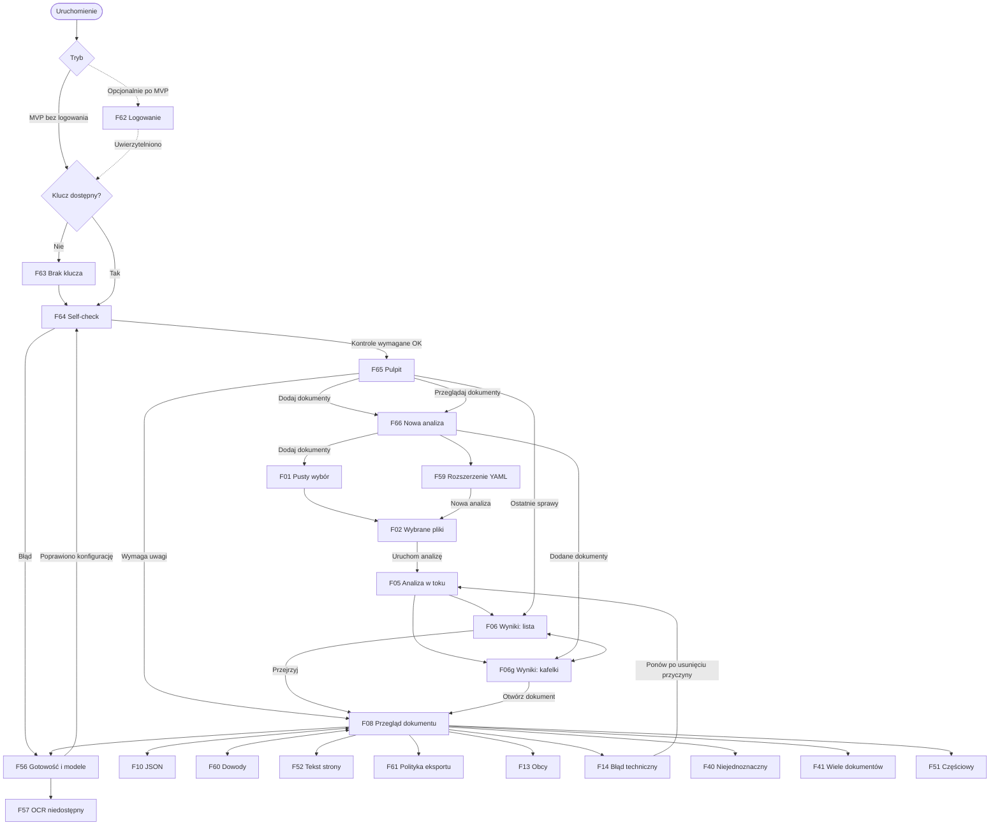
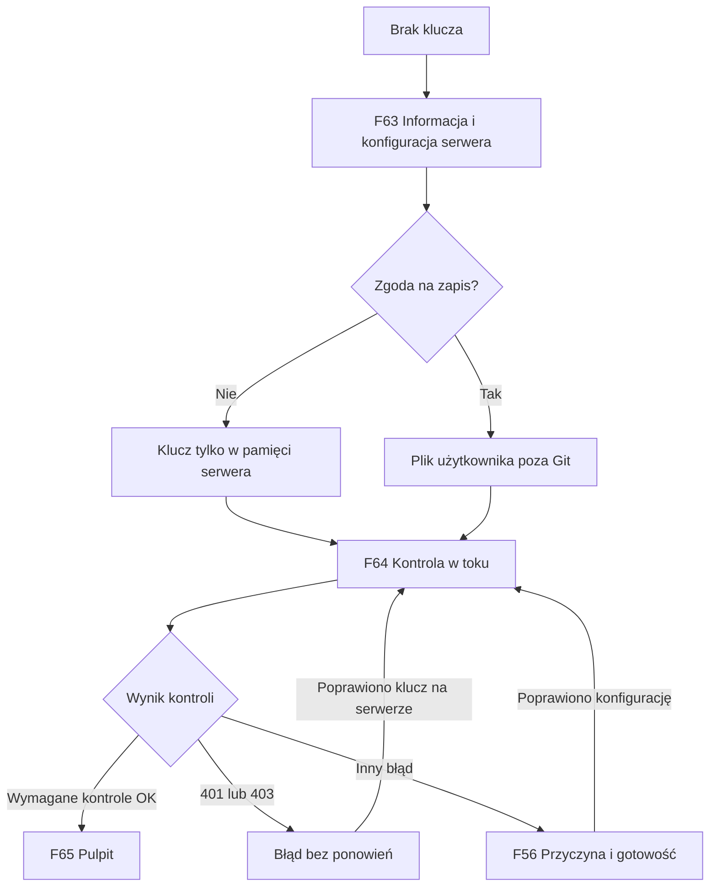
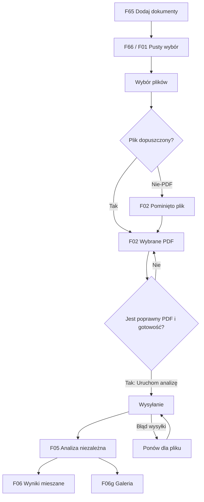
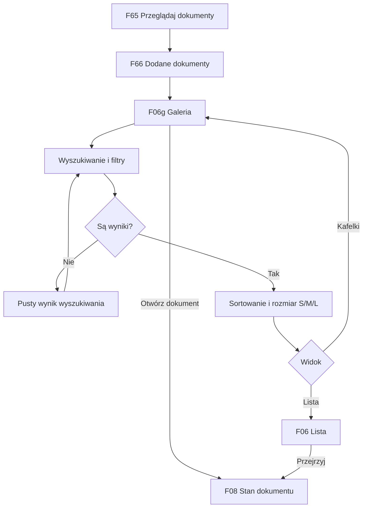
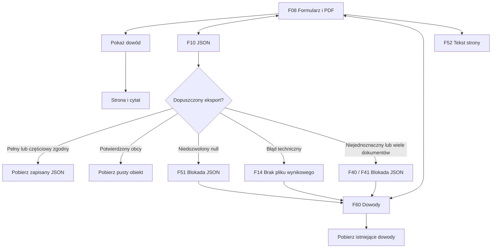
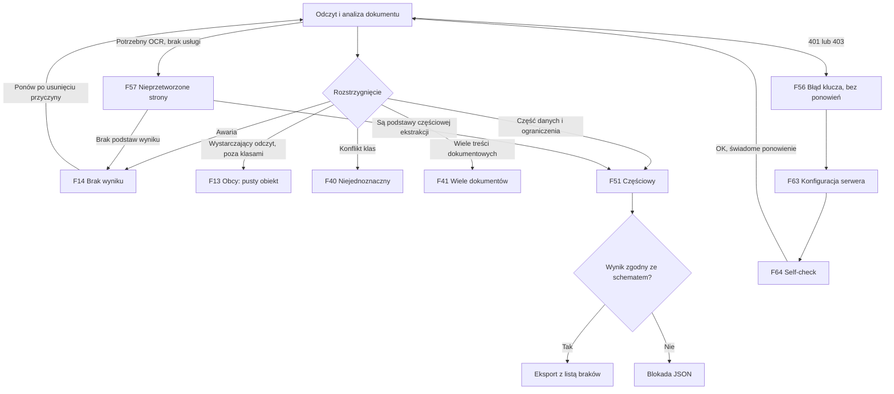
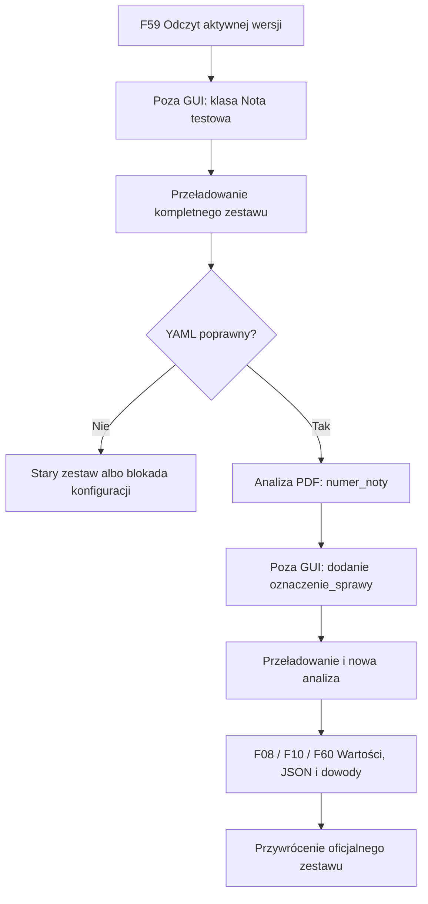
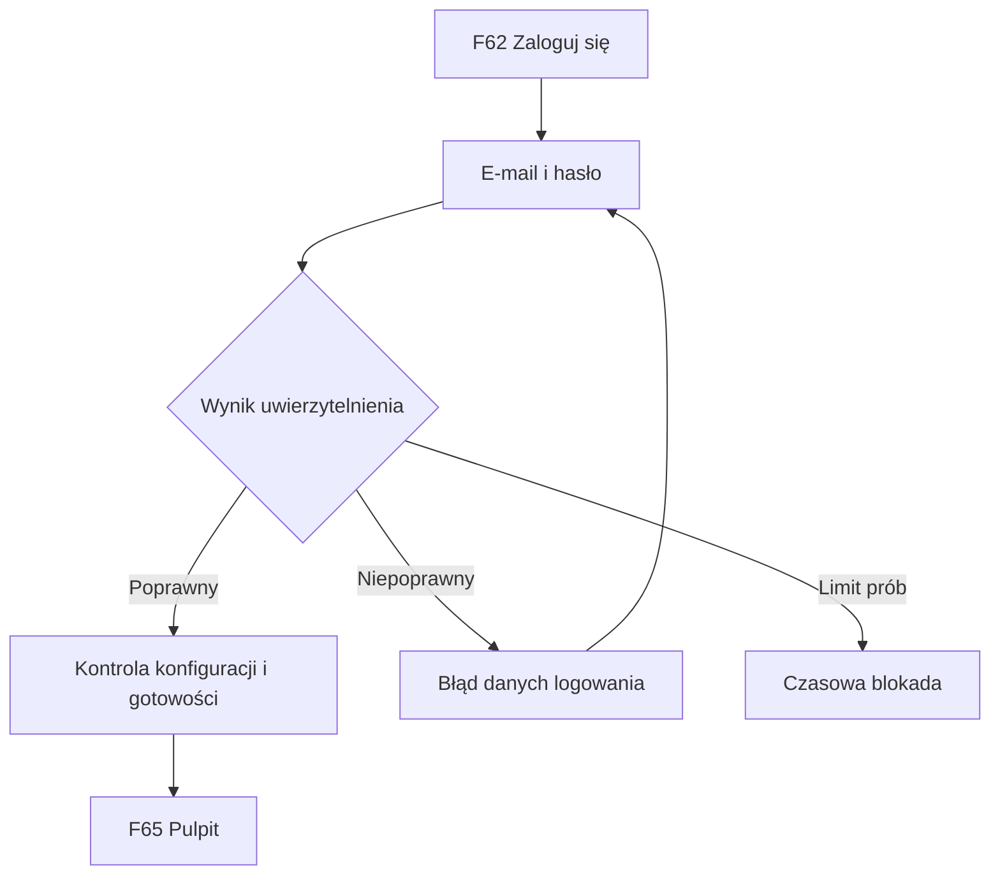

# USER FLOW aplikacji Odwołania2JSON

## 1. Zakres i zasady

Dokument opisuje nawigację, działania użytkownika, reakcje systemu i warunki eksportu. Nie potwierdza działania aplikacji ani wykonania testów.

Podstawa:

- [Projekt UI](../../04-architektura/gui/projekt-ui.md), przede wszystkim §3 i §4.
- [ADR-002](../../07-decyzje/ADR-002-decyzje-po-recenzji.md).
- [Architektura wewnętrzna](../../04-architektura/architektura-wewnetrzna.md), przede wszystkim §6, §9.1 i §10.
- [Pytania otwarte](../../07-decyzje/pytania-otwarte.md).
- Opis ekranów FigCraft i decyzje użytkownika z rozmowy 2026-11-21.

Przy rozbieżnościach obowiązują decyzje użytkownika z rozmowy 2026-11-21 ([ADR-002, uzupełnienie 0.7.0](../../07-decyzje/ADR-002-decyzje-po-recenzji.md)). Dotyczy to zwłaszcza wariantu A eksportu i zakazu zastępczego `{}` przy awarii.

### 1.1. Reguły wspólne

| Obszar | Reguła |
|---|---|
| MVP | Bez kont i logowania. Stały baner: „Tryb demonstracyjny. Tylko dane syntetyczne. Bez logowania.” |
| Dokument | Jeden PDF jest jednym dokumentem. Dokumenty analizowane niezależnie; braków nie uzupełnia się z innych plików. |
| Klasyfikacja | Rozstrzyga treść, nie nazwa pliku. Brak odczytu nie uzasadnia klasy „obcy”. |
| Eksport | Wariant A: ścisła walidacja. Niedozwolony `null`, błąd techniczny, niejednoznaczność lub wiele dokumentów blokują oceniany JSON. |
| Awaria | Brak wyniku ekstrakcji i brak zastępczego `{}`. Poprzedni wynik z cache nie zastępuje bieżącej awarii. |
| Obcy | Potwierdzony dokument obcy daje dokładnie `{}` jako `{nazwa_bazowa}.json`. |
| Dowody | Dowody, diagnozy i raport pozostają poza ocenianym JSON. |
| Klucz API | Sekret pozostaje po stronie serwera, poza Git, logami i artefaktami wynikowymi. Domyślnie tylko w pamięci serwera; zapis wymaga osobnej zgody. |
| Self-check | Sprawdza połączenie, autoryzację, model i gotowość OCR. Licencja i lokalizacja wymagają zweryfikowanych metadanych; poprawne HTTP ich nie potwierdza. |
| 401/403 API | Bez pętli ponowień. Kolejna kontrola po poprawieniu konfiguracji. |
| OCR | Niedostępność OCR oznacza jawne ograniczenie odczytu, wynik częściowy albo błąd techniczny. Nigdy automatycznie „obcy”. |
| Propozycje | `[PROP]` oznacza rozwiązanie wymagające zatwierdzenia. |

F65, F66 i F06g rozszerzają układ opisany w repozytorium. Ich obecność w tym dokumencie nie oznacza rozszerzenia zatwierdzonego P0 o wszystkie funkcje docelowe.

### 1.2. Odnośniki do ekranów

Odnośniki prowadzą do identyfikatorów ramek w tym dokumencie. Adresów tablicy FigCraft nie dostarczono.

| F-ID | Ekran lub wariant |
|---|---|
| F62 | Logowanie, opcjonalnie po MVP |
| F63 | Brak klucza API; makieta pola klucza i zgody na zapis |
| F64 | Kontrola połączenia: w toku, powodzenie, błąd |
| F65 | Pulpit |
| F66 | Nowa analiza: „Dodaj dokumenty”, „Dodane dokumenty” |
| F01 | S01: pusty wybór dokumentów |
| F02 | S01: wybrane pliki, także pominięty nie-PDF |
| F05 | S02: analiza w toku |
| F06 | S02: wyniki mieszane, lista/tabela |
| F06g | S02: galeria dokumentów |
| F08 | S03: przegląd dokumentu z dowodem |
| F10 | S03: zakładka „JSON” |
| F60 | S03: zakładka „Dowody” i pobranie |
| F13 | Dokument obcy |
| F14 | Błąd techniczny |
| F40 | Niejednoznaczna klasa |
| F41 | Wiele dokumentów w jednym PDF |
| F51 | Wynik częściowy i powody braków |
| F52 | Tekst strony z OCR |
| F56 | Karta modeli i gotowości |
| F57 | OCR niedostępny |
| F59 | Dodanie klasy i pola przez YAML poza GUI |
| F61 | Polityka eksportu |

## 2. Mapa nawigacji

**Cel:** dotrzeć od uruchomienia do analizy, przeglądu i dopuszczonego eksportu.  
**Aktor:** użytkownik MVP; konfigurujący serwer przy kluczu i YAML.  
**Warunki wstępne:** uruchomiony serwer aplikacji.

F13, F14, F40, F41 i F51 są wariantami stanu dokumentu. F56, F59 i F61 nie wymagają osobnych nowych stron.

| Nr | Ekran F-ID | Akcja użytkownika | Reakcja systemu | Stany/komunikaty |
|---|---|---|---|---|
| 1 | [F65](#f65) | Wybiera kafelek | Otwiera odpowiednią zakładkę F66 | „Dodaj dokumenty”, „Przeglądaj dokumenty” |
| 2 | [F65](#f65) | Wybiera pozycję listy | Otwiera sprawę albo wskazany dokument | „Wymaga uwagi”, „Ostatnie sprawy” |
| 3 | [F66](#f66) | Przełącza zakładkę | Pokazuje wybór plików albo dodane dokumenty | „Dodaj dokumenty”, „Dodane dokumenty” |
| 4 | [F06](#f06), [F06g](#f06g) | Otwiera dokument | Pokazuje jego bieżący stan | „Przejrzyj”; dla awarii „Ponów” |
| 5 | [F08](#f08) | Wybiera zakładkę lub wraca do sprawy | Zmienia widok tego samego wyniku albo wraca do S02 | „Formularz”, „JSON”, „Dowody” |

**Decyzje:** dostępność klucza, wynik self-check, wybrana zakładka, stan dokumentu.  
**Wyjścia i błędy:** szczegóły w przepływach 3–9; błąd nawigacji nie uruchamia analizy.  
**Kryteria akceptacji:** MVP omija F62; każdy dokument można otworzyć ze sprawy; zakładki dotyczą tego samego dokumentu i wyniku.

Docelowe strony S04–S14 z projektu UI obejmują sprawy, historię, klasy, pomoc, administrację, ustawienia, logowanie, dostępność i błędy. Pozostają poza szczegółowymi przepływami tego dokumentu. Nie przypisuje się im nowych F-ID.

## 3. Pierwsze uruchomienie: brak klucza → F63 → F64 → F65

**Cel:** uzyskać gotowość wymaganych usług przed analizą.  
**Aktor:** użytkownik uruchamiający aplikację; osoba konfigurująca serwer.  
**Warunki wstępne:** brak klucza w środowisku i pliku konfiguracji.

**Konflikt do rozstrzygnięcia:** F63 zawiera pole klucza, natomiast projekt UI §3.1.1 wyklucza takie pole. Wpisanie sekretu do pola przeglądarkowego oznacza jego obecność w przeglądarce. Poniższy przepływ zachowuje zakaz: klucz podaje się przez interaktywny mechanizm serwera. Sposób realizacji pola F63 pozostaje otwarty.

| Nr | Ekran F-ID | Akcja użytkownika | Reakcja systemu | Stany/komunikaty |
|---|---|---|---|---|
| 1 | [F63](#f63) | Uruchamia aplikację | Wykrywa brak klucza; blokuje analizę wymagającą modelu | „Brak klucza API modelu. Skonfiguruj klucz po stronie serwera zgodnie z instrukcją uruchomienia.” |
| 2 | [F63](#f63) | Podaje klucz w mechanizmie serwera; wybiera zgodę na zapis | Bez zgody przechowuje sekret tylko w pamięci serwera; za zgodą zapisuje poza Git | Dokładne etykiety pola i zgody nie są określone w repozytorium |
| 3 | [F64](#f64) | Kończy konfigurację | Wykonuje self-check | Kontrola w toku; dokładny tekst nieokreślony |
| 4 | [F64](#f64), [F56](#f56) | Odczytuje wynik | Pokazuje stan, czas kontroli, model, metadane i OCR | Powodzenie tylko po wymaganych kontrolach |
| 5 | [F64](#f64) | Odczytuje odmowę API | Kończy próbę bez pętli ponowień | „API odrzuciło uwierzytelnienie (401)” albo „API odmówiło dostępu (403). Sprawdź uprawnienia klucza na serwerze.” |
| 6 | [F65](#f65) | Przechodzi do pracy | Pokazuje stan usług, liczniki i dostępne działania | „Dodaj dokumenty”, „Przeglądaj dokumenty” |

**Decyzje:** zgoda na zapis; poprawność autoryzacji; potwierdzenie modelu, licencji i lokalizacji; gotowość OCR. Brak OCR dopuszcza wyłącznie jawny tryb ograniczony do tekstu, jeżeli wymagane kontrole LLM zakończyły się poprawnie.

**Wyjścia i kody błędów:**

- Gotowość: F65.
- Brak lub odrzucenie klucza: `llm_autoryzacja`; HTTP 401/403.
- Wadliwa konfiguracja: `konfiguracja_niepoprawna`.
- Niepotwierdzone metadane: „Model, licencja lub lokalizacja niepotwierdzone. Wywołania zablokowane.”
- Brak OCR: przepływ 7.6.

**Kryteria akceptacji:** brak zgody nie powoduje zapisu sekretu; sekret nie trafia do frontendu ani logów; 401/403 kończy próbę; samo połączenie HTTP nie daje potwierdzenia zgodności; przed rozstrzygnięciem konfliktu F63 przepływ nie jest gotowy do implementacji pola klucza.

## 4. Dodanie dokumentów i analiza

**Cel:** utworzyć paczkę roboczą i przeanalizować każdy PDF niezależnie.  
**Aktor:** użytkownik MVP.  
**Warunki wstępne:** odczytane limity backendu; do uruchomienia analizy poprawny self-check wymaganych usług.

| Nr | Ekran F-ID | Akcja użytkownika | Reakcja systemu | Stany/komunikaty |
|---|---|---|---|---|
| 1 | [F65](#f65), [F66](#f66), [F01](#f01) | Wybiera „Dodaj dokumenty” | Pokazuje strefę wyboru | „Nowa analiza”, „Wybierz pliki”; pusty stan „Nie masz jeszcze żadnych analiz.” |
| 2 | [F01](#f01) | Wybiera PDF lub przeciąga pliki | Waliduje typ, rozmiar i duplikaty | „Upuść, aby dodać” |
| 3 | [F02](#f02) | Sprawdza wybór; usuwa plik albo czyści listę | Aktualizuje listę i liczbę plików | „Wybrane pliki ({n})”, „Usuń z listy”, „Wyczyść” |
| 4 | [F02](#f02) | Odczytuje zasady grupowania | Pokazuje niezależność dokumentów | „Pliki wybrane razem tworzą jedną paczkę roboczą. Każdy dokument analizujemy niezależnie; nie uzupełniamy danych z innych plików.” |
| 5 | [F02](#f02) | Wybiera „Uruchom analizę” | Wysyła pliki; pokazuje postęp | „Wysyłanie {k} z {n}…”, „Anuluj wysyłanie” |
| 6 | [F05](#f05) | Obserwuje analizę | Pokazuje kolejkę i bieżące etapy per dokument | „W kolejce”; „Analizowanie: {etap}” |
| 7 | [F05](#f05) | Czeka na zakończenie | Aktualizuje postęp i wyniki niezależnie | „Przetworzono {k} z {n} dokumentów · {mm:ss}”; „{plik}: gotowe” |
| 8 | [F06](#f06), [F06g](#f06g) | Odczytuje podsumowanie | Pokazuje rzeczywiste stany, także mieszane | „Analiza zakończona. Podsumowanie wyników: {liczniki grup stanów i banerów P0}.” |

Etapy: „Odczyt tekstu”, „OCR” tylko gdy potrzebny, „Klasyfikacja”, „Ekstrakcja”, „Walidacja”.

**Decyzje:** dopuszczalność pliku; gotowość modelu; potrzeba OCR; wynik każdego dokumentu; prezentacja jako lista lub galeria. `[PROP]` Automatyczne otwarcie F06g od **7 dokumentów w sprawie**. Próg nie jest zatwierdzony.

**Wyjścia i błędy:**

| Sytuacja | Wyjście lub komunikat |
|---|---|
| Nie-PDF | „{nazwa}: to nie jest PDF — pominięto.” |
| Zbyt duży plik | „{nazwa}: plik przekracza {limit_mb} MB.” |
| Duplikat w wyborze | „{nazwa}: ten sam plik jest już na liście.” |
| Brak limitów | „Nie pobrano limitów”; upload zablokowany |
| Błąd wysyłki | „Nie udało się wysłać. Spróbuj ponownie.”; „Ponów” dla pliku |
| Część analiz nieudana | F06/F06g; „Ponów nieudane”; pozostałe wyniki dostępne |
| Odrzucony klucz | Przepływ 7.8 |

**Kryteria akceptacji:** nie-PDF nie trafia do analizy; pliki nie uzupełniają się wzajemnie; błąd jednego dokumentu nie zatrzymuje pozostałych; odświeżenie widoku nie tworzy drugiej analizy; licznik zakończonych nie oznacza liczby sukcesów.

## 5. Przeglądanie dodanych dokumentów

**Cel:** odnaleźć dokument i wejść w jego przegląd.  
**Aktor:** użytkownik MVP.  
**Warunki wstępne:** dokumenty dostępne w bieżącej sesji; wybrany zakres sprawy. Zakres F66 między wieloma sprawami wymaga doprecyzowania.

| Nr | Ekran F-ID | Akcja użytkownika | Reakcja systemu | Stany/komunikaty |
|---|---|---|---|---|
| 1 | [F65](#f65), [F66](#f66) | Wybiera „Przeglądaj dokumenty” | Otwiera zakładkę wyników | „Dodane dokumenty” |
| 2 | [F06g](#f06g) | Przegląda kafelki z podglądem | Pokazuje plik, klasę, status i dane wyniku | Domyślne sortowanie „Wymaga uwagi najpierw” |
| 3 | [F06g](#f06g) | Wpisuje zapytanie | Zawęża widoczne dokumenty | Dokładny placeholder i zakres wyszukiwania nieokreślone |
| 4 | [F06g](#f06g) | Ustawia filtry | Zawęża zbiór | „Status”, „Klasa”, „Źródło tekstu”, „Kody odstępstw” |
| 5 | [F06g](#f06g) | Wybiera kilka kodów | Stosuje OR między kodami oraz AND ze statusem i klasą | „Wyczyść kody”; „Brak dokumentów z wybranymi kodami” |
| 6 | [F06g](#f06g) | Zmienia sortowanie i rozmiar | Zmienia kolejność albo wielkość kafelków | „Wymaga uwagi najpierw”, S/M/L; pozostałe opcje sortowania wymagają potwierdzenia |
| 7 | [F06g](#f06g), [F06](#f06) | Wybiera „Lista” lub „Kafelki” | Zmienia prezentację dokumentów | „Kafelki/Lista” |
| 8 | [F06g](#f06g), [F06](#f06) | Otwiera dokument | Pokazuje właściwy wynik lub stan wyjątkowy | „Przejrzyj”; dla błędu „Ponów” |

`[PROP]` Wyszukiwanie, filtry i sortowanie pozostają zachowane przy zmianie Kafelki/Lista oraz powrocie z dokumentu. Reguła wymaga zatwierdzenia.

**Decyzje:** zakres dokumentów; zapytanie; filtry; kolejność; rozmiar; tryb prezentacji. Logika łączenia filtra źródła tekstu z pozostałymi nie jest określona.

**Wyjścia i błędy:** F08 albo jego wariant; pusta lista; KS-2 przy błędzie odczytu. „Nie zgłoszono odstępstw” oznacza brak zgłoszonych kodów, nie potwierdzenie bezbłędności. Nieznany kod: „Nieznany kod: {kod}”.

**Kryteria akceptacji:** wybór kafelka otwiera właściwy dokument; status ma tekst i ikonę; zmiana rozmiaru nie zmienia danych; filtr kodów działa według opisanej logiki; lista i kafelki nie uruchamiają ponownej analizy.

## 6. Przegląd dokumentu i eksport według wariantu A

**Cel:** porównać dane z PDF, sprawdzić dowody i pobrać dopuszczone artefakty.  
**Aktor:** użytkownik MVP.  
**Warunki wstępne:** dokument dostępny; zapisany wynik albo jawna diagnoza braku wyniku.

| Nr | Ekran F-ID | Akcja użytkownika | Reakcja systemu | Stany/komunikaty |
|---|---|---|---|---|
| 1 | [F08](#f08) | Otwiera dokument | Pokazuje PDF obok formularza, nazwę, klasę i status | „Wynik v1 · silnik”; „Formularz” domyślnie |
| 2 | [F08](#f08) | Wybiera pole i „Pokaż dowód” | Przechodzi do strony i pokazuje fragment | „Pokazano dowód: strona 1”; źródło „tekst PDF / OCR”, metoda „reguła / model / wyliczone” |
| 3 | [F52](#f52) | Przełącza „PDF \| Tekst strony” | Pokazuje tekst faktycznie odczytany przez silnik | Po wykonanym OCR: „Skan — tekst z OCR” |
| 4 | [F10](#f10) | Otwiera „JSON” | Pokazuje zapisany wynik tylko do odczytu i rewizję kontraktu | „Zapisany wynik v{n}. Dowody są osobno.”; „Kontrakt: {rewizja}” |
| 5 | [F10](#f10) | Wybiera „Kopiuj” | Kopiuje pokazany zapisany wynik | „Skopiowano” przez 2 s |
| 6 | [F60](#f60) | Otwiera „Dowody” | Pokazuje pole, wartość, stronę, fragment, źródło tekstu i metodę | „Pole”, „Wartość”, „Strona”, „Fragment”, „Źródło tekstu”, „Metoda” |
| 7 | [F61](#f61), [F10](#f10) | Sprawdza możliwość pobrania | Stosuje wariant A | Nazwa polityki: „Wariant A: ścisła walidacja eksportu”; bez przełącznika wariantów w P0 |
| 8 | [F10](#f10) | Wybiera „Pobierz {nazwa}.json” | Udostępnia zapisany, dopuszczony wynik | Nazwa bazowa zgodna z wejściowym PDF |
| 9 | [F60](#f60) | Wybiera „Pobierz dowody (JSON)” | Udostępnia dowody osobno od ocenianego JSON | `evidence/{nazwa_bazowa}.json` |

### 6.1. Decyzja eksportowa F61

| Stan dokumentu | Oceniany JSON | Dowody i raport |
|---|---|---|
| Pełny; wynik zgodny z kontraktem | Pobranie dostępne | Osobno |
| Częściowy; wszystkie wartości i `null` dopuszczone | Pobranie dostępne z ostrzeżeniem i listą braków | Osobno |
| Częściowy; `null` niedopuszczony | „Pobierz JSON” nieaktywny; „Brak wartości niezgodny z kontraktem: {ścieżki}” | Dostępne istniejące materiały |
| Błąd techniczny | „Nie zapisano pliku wynikowego”; pobranie nieaktywne | Raport i istniejące dowody; „Materiał częściowy, analiza nieudana” |
| Potwierdzony obcy | Dokładnie `{}` jako `{nazwa_bazowa}.json` | Uzasadnienie osobno |
| Niejednoznaczny | Brak ocenianego JSON i eksportu | Istniejące materiały diagnostyczne |
| Wiele dokumentów | Eksport zablokowany do ustalenia kontraktu | Istniejące materiały diagnostyczne |
| Nieznany stan backendu | Eksport zablokowany | „Nieznany stan. Wymaga sprawdzenia” |

Podgląd diagnostyczny niezgodnego JSON musi być jawnie odróżniony od wyniku do oceny. Nie udostępnia się obejścia blokady przez kopiowanie go jako ocenianego wyniku.

**Decyzje:** stan dokumentu; walidacja schematu; dopuszczalność `null`; istnienie dowodów.

**Wyjścia i kody błędów:** pobrany JSON, osobne dowody/raport albo blokada; `walidacja_wyniku_nieudana` przy naruszeniu schematu. Błędy techniczne według przepływu 7.1.

**Kryteria akceptacji:** oceniany JSON zawiera wyłącznie kontraktowe dane, z zachowaniem kluczy, kolejności i typów; dowody i raport nie są do niego dopisywane; niedozwolony `null` blokuje pobranie; awaria nie daje `{}`; MVP nie udostępnia korekty ani zatwierdzania.

## 7. Ścieżki wyjątkowe

### 7.1. Błąd techniczny i „Ponów”

**Cel:** pokazać awarię i umożliwić kontrolowane ponowienie.  
**Aktor:** użytkownik; konfigurujący serwer, jeśli wymaga tego przyczyna.  
**Warunki wstępne:** nieudana analiza dokumentu.

| Nr | Ekran F-ID | Akcja użytkownika | Reakcja systemu | Stany/komunikaty |
|---|---|---|---|---|
| 1 | [F06](#f06), [F14](#f14) | Otwiera nieudany dokument | Pokazuje brak wyniku | „Błąd techniczny”; „Nie udało się przetworzyć dokumentu” |
| 2 | [F14](#f14) | Rozwija szczegóły | Pokazuje etap, przyczynę, kod, czas i identyfikator bez sekretów | „To błąd techniczny, a nie wynik analizy. Nie zapisano wyniku ekstrakcji. Eksport przy awarii: {wybrana polityka z §3.3.5a lub nieustalona}.” Placeholder wskazuje wariant A |
| 3 | [F14](#f14), [F60](#f60) | Pobiera materiały diagnostyczne | Udostępnia raport i tylko istniejące dowody | „Nie zapisano pliku wynikowego”; „Materiał częściowy, analiza nieudana” |
| 4 | [F14](#f14), [F06](#f06) | Po usunięciu przyczyny wybiera „Ponów analizę”, „Ponów” albo „Ponów nieudane” | Ponawia wskazane nieudane dokumenty | Przejście do F05; nowy rzeczywisty rezultat |

**Decyzje:** czy przyczyna została usunięta i czy błąd dopuszcza ponowienie. 401/403 wymaga poprawienia konfiguracji.

**Wyjścia i kody:** poprawny wynik albo kolejny jawny błąd; przykładowo `llm_niedostepny`, `limit_czasu`, `llm_odpowiedz_niepoprawna`, `pdf_uszkodzony`, `pdf_zaszyfrowany`, `zapis_nieudany`.

**Kryteria akceptacji:** brak automatycznej podmiany cache; brak zastępczego `{}`; gotowe wyniki pozostałych dokumentów pozostają dostępne; odczyt strony błędu sam nie ponawia analizy.

### 7.2. Dokument obcy

**Cel:** odróżnić dokument spoza klas od awarii.  
**Aktor:** użytkownik.  
**Warunki wstępne:** wystarczający odczyt i poprawny aktywny zestaw klas.

| Nr | Ekran F-ID | Akcja użytkownika | Reakcja systemu | Stany/komunikaty |
|---|---|---|---|---|
| 1 | [F13](#f13) | Otwiera dokument | Pokazuje uzasadnienie zamiast formularza | „Dokument spoza zakresu” |
| 2 | [F13](#f13) | Sprawdza „Dlaczego?” | Pokazuje przesłanki i aktywne klasy | „Treść nie pasuje do żadnej aktywnej klasy: {nazwy klas z konfiguracji}. Zgodnie z zasadami zapisano pusty wynik {} pod nazwą {plik}.json.” |
| 3 | [F10](#f10), [F13](#f13) | Otwiera JSON i pobiera wynik | Pokazuje oraz pobiera dokładnie `{}` | „Pobierz {plik}.json” |

**Decyzje:** wystarczający odczyt i brak dopasowania do klas.  
**Wyjścia i kody:** `{nazwa_bazowa}.json`; kod katalogu `dokument_obcy`, bez błędu technicznego.  
**Kryteria akceptacji:** nazwa bazowa pochodzi z wejścia; treść pliku to `{}`; brak OCR lub odmowa API nie prowadzą do tego stanu.

### 7.3. Niejednoznaczna klasa

**Cel:** ujawnić brak rozstrzygnięcia bez wymuszania klasy.  
**Aktor:** użytkownik.  
**Warunki wstępne:** analiza zwróciła konflikt kandydatów klas.

| Nr | Ekran F-ID | Akcja użytkownika | Reakcja systemu | Stany/komunikaty |
|---|---|---|---|---|
| 1 | [F40](#f40) | Otwiera dokument | Pokazuje baner i dostępny powód | „Nie ustalono jednoznacznie klasy dokumentu. Wymaga przeglądu.” |
| 2 | [F40](#f40), [F60](#f60) | Przegląda dostępne dowody | Udostępnia istniejące materiały; blokuje JSON | „Niejednoznaczny” |

**Decyzje:** brak automatycznego wyboru klasy w P0. Rozbudowany panel kandydatów i ręczny wybór klasy pozostają poza MVP.  
**Wyjścia i kody:** powrót do sprawy; brak ocenianego JSON; `klasa_niejednoznaczna`.  
**Kryteria akceptacji:** stan nie jest przedstawiany jako „obcy” ani awaria; eksport pozostaje zablokowany.

### 7.4. Wiele dokumentów w jednym PDF

**Cel:** pokazać diagnozę wielu dokumentów bez nieuzgodnionego eksportu.  
**Aktor:** użytkownik.  
**Warunki wstępne:** wykryto wiele odrębnych treści dokumentowych.

| Nr | Ekran F-ID | Akcja użytkownika | Reakcja systemu | Stany/komunikaty |
|---|---|---|---|---|
| 1 | [F41](#f41) | Otwiera dokument | Pokazuje baner i zakresy stron, jeśli znane | „Wykryto wiele dokumentów w jednym PDF. Sprawdź podział.” |
| 2 | [F41](#f41) | Przegląda PDF i dostępne dowody | Zachowuje odniesienia do stron oryginału; blokuje eksport | „Kontrakt eksportu wielu dokumentów nieustalony” |

**Decyzje:** kontrakt eksportu wymaga rozstrzygnięcia U-Q12. P0 nie oferuje wyboru segmentów.  
**Wyjścia i kody:** powrót do sprawy; ostrzeżenie `wiele_dokumentow`; brak ocenianego JSON.  
**Kryteria akceptacji:** system nie scala danych, nie eksportuje tablicy dokumentów i nie wybiera pierwszego segmentu jako zastępstwa całości. Jeden PDF nadal jest jedną jednostką wejścia.

### 7.5. Wynik częściowy i pięć powodów braków

**Cel:** wskazać zakres ograniczeń i sprawdzić dopuszczalność eksportu.  
**Aktor:** użytkownik.  
**Warunki wstępne:** istnieją podstawy częściowej ekstrakcji.

| Nr | Ekran F-ID | Akcja użytkownika | Reakcja systemu | Stany/komunikaty |
|---|---|---|---|---|
| 1 | [F51](#f51) | Otwiera dokument | Pokazuje listę braków i pokrycie stron | „Wynik częściowy. Sprawdź listę braków ({n}).” |
| 2 | [F51](#f51) | Wybiera filtr braków lub ostrzeżeń | Zawęża pola | „Braki ({n})”; „Do sprawdzenia ({n})” |
| 3 | [F51](#f51), [F08](#f08) | Sprawdza pole | Pokazuje właściwy powód i istniejące dowody | Komunikaty z tabeli poniżej |
| 4 | [F61](#f61), [F10](#f10) | Sprawdza pobranie | Stosuje wariant A | Dopuszczony eksport albo „Brak wartości niezgodny z kontraktem: {ścieżki}” |

| Powód | Dokładna treść przy polu |
|---|---|
| Brak | „Nie znaleziono informacji. Sprawdzone strony: {lista}.” |
| Nie dotyczy | „Nie dotyczy: {reguła i przesłanki}.” |
| Nieczytelne | „Treść jest obecna, ale nie można jej odczytać.” |
| Sprzeczne | „Znaleziono sprzeczne wartości. Porównaj dowody.” |
| Nieprzetworzone | „Nie przetworzono stron/regionów: {lista}.” |

**Decyzje:** powód braku; zakres odczytu; dopuszczalność `null` przez schemat. „Do sprawdzenia” jest osobną flagą, także dla obecnej wartości.

**Wyjścia i kody:** zgodny JSON albo blokada; `walidacja_wyniku_nieudana` przy naruszeniu schematu. Powody braków pozostają poza ocenianym JSON.

**Kryteria akceptacji:** system nie zastępuje braków pustym tekstem ani fikcyjną wartością; „Nieprzetworzone” nie staje się „Brak”; uzasadniony legalny `null` sam nie wymusza statusu częściowego.

### 7.6. OCR niedostępny

**Cel:** umożliwić pracę z tekstowymi PDF i ujawnić ograniczenia skanów.  
**Aktor:** użytkownik.  
**Warunki wstępne:** brak lub awaria komponentu OCR.

| Nr | Ekran F-ID | Akcja użytkownika | Reakcja systemu | Stany/komunikaty |
|---|---|---|---|---|
| 1 | [F56](#f56), [F57](#f57) | Sprawdza gotowość | Pokazuje rzeczywistą niedostępność | „OCR niedostępny. Strony wymagające OCR pozostaną nieprzetworzone.” |
| 2 | [F02](#f02), [F05](#f05) | Analizuje tekstowy PDF w trybie ograniczonym | Przetwarza dostępny tekst | Brak deklaracji gotowości do skanów |
| 3 | [F57](#f57), [F51](#f51) | Otwiera dokument wymagający OCR | Wskazuje nieprzetworzone strony; daje częściowy wynik, jeśli są podstawy | „Skan, nieprzetworzony: OCR niedostępny” |
| 4 | [F14](#f14) | Otwiera skan bez podstaw do wyniku | Pokazuje błąd techniczny | „Nie zapisano pliku wynikowego” |
| 5 | [F56](#f56) | Po naprawie wybiera „Sprawdź ponownie” | Kontroluje usługę bez analizy PDF | Aktualny stan i czas sprawdzenia |

**Decyzje:** czy potrzebny jest OCR; czy dostępny tekst wystarcza do częściowej ekstrakcji; czy wynik przechodzi schemat.

**Wyjścia i kody:** wynik tekstowy, częściowy albo błąd techniczny; `ocr_niedostepny` lub `ocr_blad`. Ponowna analiza wymaga osobnego działania.

**Kryteria akceptacji:** niedostępność OCR nie daje klasy „obcy”; etykieta „Skan — tekst z OCR” pojawia się dopiero po wykonanym OCR; shim jest jawnie oznaczony w UI i dowodach.

### 7.7. Plik nie-PDF

**Cel:** odrzucić niedopuszczony format bez utraty poprawnych plików.  
**Aktor:** użytkownik.  
**Warunki wstępne:** wybór obejmuje plik nie-PDF.

| Nr | Ekran F-ID | Akcja użytkownika | Reakcja systemu | Stany/komunikaty |
|---|---|---|---|---|
| 1 | [F01](#f01), [F02](#f02) | Dodaje pliki | Pomija nie-PDF | „{nazwa}: to nie jest PDF — pominięto.” |
| 2 | [F02](#f02) | Sprawdza listę | Zachowuje dopuszczone PDF | „Wybrane pliki ({n})” |
| 3 | [F02](#f02) | Uruchamia analizę poprawnych plików | Analizuje wyłącznie dopuszczone PDF | „Uruchom analizę” |

**Decyzje:** czy pozostał co najmniej jeden dopuszczony PDF.  
**Wyjścia i kody:** dalszy wybór albo analiza; kod maszynowy odrzucenia nie-PDF nie jest określony w przywołanych źródłach.  
**Kryteria akceptacji:** pominięty plik nie jest zadaniem analizy, dokumentem obcym ani błędem ekstrakcji; bez dopuszczonego PDF analiza nie startuje.

### 7.8. Błąd klucza w trakcie pracy

**Cel:** zatrzymać nieskuteczne wywołania i przywrócić możliwość analizy po poprawie konfiguracji.  
**Aktor:** użytkownik i konfigurujący serwer.  
**Warunki wstępne:** wcześniej działające API zwraca 401 lub 403.

| Nr | Ekran F-ID | Akcja użytkownika | Reakcja systemu | Stany/komunikaty |
|---|---|---|---|---|
| 1 | [F05](#f05), [F14](#f14), [F56](#f56) | Odczytuje błąd zadania | Oznacza dotknięty dokument jako technicznie nieudany; aktualizuje gotowość | „API odrzuciło uwierzytelnienie (401)” lub „API odmówiło dostępu (403). Sprawdź uprawnienia klucza na serwerze.” |
| 2 | [F56](#f56) | Przegląda wcześniejsze wyniki | Umożliwia odczyt zapisanych wyników; blokuje nowe analizy wymagające modelu | Bez automatycznych ponowień |
| 3 | [F63](#f63) | Poprawia klucz po stronie serwera | Przyjmuje nową konfigurację bez ujawniania sekretu | Obowiązuje konflikt pola F63 opisany w §3 |
| 4 | [F64](#f64) | Uruchamia ponowną kontrolę po poprawie | Wykonuje self-check | W toku, powodzenie albo jawny błąd |
| 5 | [F06](#f06), [F14](#f14) | Po sukcesie wybiera „Ponów nieudane” lub „Ponów analizę” | Ponawia nieudane dokumenty | F05 |

**Decyzje:** wynik nowego self-check; świadome ponowienie zadania. 401 nie dowodzi samodzielnie, że klucz wygasł.

**Wyjścia i kody:** przywrócona gotowość albo dalsza blokada; HTTP 401/403, `llm_autoryzacja`.

**Kryteria akceptacji:** brak pętli ponowień i podstawienia starego wyniku; dotychczasowe poprawne wyniki pozostają dostępne; poprawienie klucza nie uruchamia automatycznie ponownej ekstrakcji.

## 8. Rozbudowa klas i pól przez YAML poza GUI

**Cel:** wykazać dodanie klasy i pola przy użyciu istniejących mechanizmów silnika.  
**Aktor:** osoba konfigurująca zestaw YAML; użytkownik wykonujący analizę testową.  
**Warunki wstępne:** osobny demonstracyjny zestaw YAML i syntetyczny PDF; materiały organizatora pozostają niezmienione.

| Nr | Ekran F-ID | Akcja użytkownika | Reakcja systemu | Stany/komunikaty |
|---|---|---|---|---|
| 1 | [F59](#f59), [F56](#f56) | Odczytuje konfigurację | Pokazuje aktywną wersję | „Konfiguracja klas: {wersja}, {liczba} klas” |
| 2 | [F59](#f59) | Poza GUI dodaje „Notę testową” z `numer_noty` | Przyjmuje konfigurację po walidacji i przeładowaniu | Bez edytora YAML w GUI |
| 3 | [F59](#f59), [F66](#f66) | Restartuje serwer z nowym zestawem i odświeża widok | Pokazuje nową wersję; wcześniejsze zadania zachowują swoją | „Odśwież konfigurację” tylko odczytuje stan backendu |
| 4 | [F02](#f02), [F05](#f05), [F08](#f08) | Analizuje syntetyczny PDF | Rozpoznaje klasę i odczytuje `numer_noty` | Wartość `NT-2026-001` z dowodem |
| 5 | [F59](#f59) | Poza GUI dodaje `oznaczenie_sprawy`; ponownie przeładowuje i analizuje | Nowy wynik używa drugiej wersji YAML | Wartość `DEMO-42` z dowodem |
| 6 | [F10](#f10), [F60](#f60) | Pobiera JSON i dowody | Udostępnia rzeczywiście wyekstrahowane wartości | „Przykład rozszerzenia, poza kontraktami konkursowymi” |
| 7 | [F59](#f59), [F56](#f56) | Przywraca oficjalny zestaw | Pokazuje przywróconą wersję | Nowe analizy używają oficjalnych klas |

**Decyzje:** poprawność YAML; dostępność istniejącego mechanizmu ekstrakcji; obecność poprzedniego poprawnego zestawu. Przeładowanie bez restartu pozostaje otwarte.

**Wyjścia i kody:** nowa konfiguracja i testowy wynik albo `konfiguracja_niepoprawna`. Niepoprawny zestaw pozostawia poprzedni aktywny, jeśli jest dostępny; w przeciwnym razie blokuje analizę.

**Kryteria akceptacji:** dwa kolejne zestawy dają rzeczywistą ekstrakcję klasy i obu pól; formularz bez ekstrakcji nie zalicza pokazu; istniejące wyniki zachowują przypięty YAML; nie zmienia się kodu ani oficjalnych kontraktów. Nowy mechanizm ekstrakcji wymaga kodu.

## 9. Logowanie na przyszłość: F62

**Cel:** umożliwić dostęp po uwierzytelnieniu w przyszłej wersji.  
**Aktor:** użytkownik z kontem.  
**Warunki wstępne:** uruchomiony mechanizm uwierzytelniania po MVP. F62 jest pomijane w MVP.

| Nr | Ekran F-ID | Akcja użytkownika | Reakcja systemu | Stany/komunikaty |
|---|---|---|---|---|
| 1 | [F62](#f62) | Otwiera aplikację w przyszłym trybie z kontami | Pokazuje formularz | „Zaloguj się”, „E-mail”, „Hasło”, „Pokaż hasło”, „Zaloguj” |
| 2 | [F62](#f62) | Podaje dane i wybiera „Zaloguj” | Weryfikuje dane | Przy błędzie: „Nieprawidłowy e-mail lub hasło.” |
| 3 | [F62](#f62) | Podejmuje kolejne nieudane próby | Po 5 próbach stosuje blokadę | „Zbyt wiele prób. Spróbuj ponownie za {n} min.” |
| 4 | [F62](#f62) | Nie ma konta | Pokazuje informację bez rejestracji samoobsługowej | „Nie masz konta? Poproś administratora.” |
| 5 | [F64](#f64), [F65](#f65) | Kończy poprawne logowanie | Przechodzi przez kontrolę gotowości do pulpitu | Uwierzytelnienie użytkownika nie potwierdza gotowości API modelu |

**Decyzje:** poprawność danych; limit prób; gotowość usług po logowaniu.

**Wyjścia i kody:** pulpit albo pozostanie na F62. Kody API logowania i czas blokady nie są określone. Błąd logowania nie jest kodem `llm_autoryzacja`.

**Kryteria akceptacji:** MVP nie wymaga konta; komunikat nie wskazuje, które pole jest błędne; 401 API modelu nie wylogowuje automatycznie użytkownika; mechanizm logowania pozostaje do wyboru.

## 10. Wspólne stany odczytu i kody

| Sytuacja | Komunikat i działanie |
|---|---|
| Ładowanie | „Wczytywanie…”; szkielety układu |
| Brak połączenia przeglądarki z backendem | „Nie udało się połączyć z serwerem. Sprawdź połączenie i spróbuj ponownie.”; „Spróbuj ponownie” |
| Nie znaleziono sprawy lub dokumentu | „Nie znaleziono tej sprawy lub dokumentu. Mógł zostać usunięty.” |
| Brak uprawnień, po MVP | „Nie masz dostępu do tej strony. Poproś administratora o nadanie roli.” |
| Brak sprawdzonej gotowości | „Nie sprawdzono gotowości” |
| Backend nie łączy się z API modelu | „Nie można połączyć z API modelu” |
| Endpoint niedostępny | „Endpoint modelu niedostępny” |
| Timeout modelu | „Przekroczono czas odpowiedzi modelu” |
| Limit API | „Osiągnięto limit zapytań. Ponów po {czas_z_API}”; bez czasu, jeśli API go nie podało |
| Brak środków | „Brak dostępnych środków API. Uzupełnij budżet po stronie dostawcy.” |

Ponowienie odczytu strony nie uruchamia ekstrakcji. Sieć i 429 mogą mieć ograniczony budżet prób i czasu; 401/403 nie uruchamiają pętli ponowień.

Kody katalogu użyte w przepływach zachowują definicje repozytorium. Architektura proponuje angielskie odpowiedniki API, m.in.:

| Kod katalogu | Odpowiednik API `[PROP]` |
|---|---|
| `llm_autoryzacja` | `llm_authorization` |
| `konfiguracja_niepoprawna` | `invalid_configuration` |
| `ocr_niedostepny` | `ocr_unavailable` |
| `ocr_blad` | `ocr_error` |
| `llm_niedostepny` | `llm_unavailable` |
| `llm_limit` | `llm_rate_limit` |
| `limit_czasu` | `time_limit` |
| `zapis_nieudany` | `write_failed` |
| `walidacja_wyniku_nieudana` | `result_validation_failed` |
| `klasa_niejednoznaczna` | `class_ambiguous` |
| `dokument_obcy` | `foreign_document` |
| `wiele_dokumentow` | `multiple_documents` |

Kod odstępstwa, stan wyniku i kod HTTP są osobnymi informacjami. Przykładowy `LLM_TIMEOUT` z makiety nie stanowi osobnego zatwierdzonego kontraktu API.

## 11. Luki i pytania otwarte

| ID | Luka lub sprzeczność | Wymagane rozstrzygnięcie |
|---|---|---|
| L01 | F63 zawiera pole klucza; projekt UI §3.1.1 wyklucza pole; architektura wewnętrzna wymaga kluczy poza frontendem | Uzgodnić sposób podania sekretu. Do tego czasu obowiązuje mechanizm po stronie serwera |
| L02 | Architektura §10 wskazuje domyślnie `empty_json`, a projekt UI pozostawia wariant otwarty | Dokument stosuje nowszą decyzję: wariant A, `no_file`, bez zastępczego `{}`. Źródła wymagają późniejszego uzgodnienia |
| L03 | Brak dokładnych tekstów F63 i stanów F64 | Ustalić etykiety pola, zgody, kontroli w toku i powodzenia bez zmiany komunikatów błędów |
| L04 | F65 i F66 nie występują w dotychczasowej mapie P0 S01–S03 | Uzgodnić wejście startowe, mapowanie stron i zakres MVP |
| L05 | Nieokreślony zakres „Dodane dokumenty” | Ustalić, czy zakładka pokazuje jedną sprawę, czy zbiór bieżącej sesji |
| L06 | Rozwinięty jest tylko filtr Status (F67 w pliku ekranów), menu sortowania (F68) i pusty wynik (F69) | Zaprojektować filtry Klasa, Źródło tekstu i Kody odstępstw oraz obsługę klawiaturą |
| L07 | Wyszukiwanie i sortowanie galerii nie mają pełnego kontraktu | Ustalić przeszukiwane dane, pozostałe opcje sortowania i kolejność równorzędnych pozycji |
| L08 | `[PROP]` Galeria automatycznie od 7 dokumentów w sprawie | Zatwierdzić albo zmienić próg; określić relację z ręcznym wyborem widoku |
| L09 | Zachowanie filtrów po zmianie widoku i powrocie nieokreślone | Zatwierdzić propozycję zachowania stanu |
| L10 | Brak ramek galerii na telefonie | Telefon pozostaje poza desktopowym P0; potrzebny osobny projekt |
| L11 | Brak zaznaczania wielu kafelków | Nie zakładać operacji na zaznaczeniu; ewentualny zakres wymaga osobnej decyzji |
| L12 | „Wiele dokumentów” jest etykietą UI, ale architektura ma pięć wyników i ostrzeżenie segmentacji | Uzgodnić mapowanie ostrzeżenia na baner i blokadę eksportu bez dodawania szóstego wyniku API |
| L13 | U-Q12: kontrakt wielu dokumentów w jednym PDF | Do odpowiedzi brak eksportu; bez scalania i dzielenia ocenianego wyniku |
| L14 | U-Q13: nieczytelne pole wymagane, którego schemat nie dopuszcza jako `null` | Do odpowiedzi wariant A blokuje eksport |
| L15 | U-Q14: sposób oceny braku pliku po awarii | Nie zmienia przyjętego tu zakazu zastępczego `{}` |
| L16 | GUI pokazuje w P0 stronę i cytat, architektura wymaga bbox w dowodach | Rozdzielić brak obrysu w GUI od brakującej geometrii artefaktu; nie deklarować pełnego dowodu bez wymaganych danych |
| L17 | Przeładowanie YAML bez restartu nieustalone | P0 dopuszcza restart; odświeżenie GUI tylko odczytuje konfigurację |
| L18 | Nieustalony mechanizm logowania i kody jego błędów | F62 pozostaje opcjonalnym przepływem po MVP |
| L19 | ADR-002 wskazuje nazwę „Arkadiana”, projekt UI i makiety „Odwołania2JSON” | Uzgodnić nazwę produktu; dokument zachowuje nazwę z projektu UI |
| L20 | Ramki FigCraft nie mają adresów URL | Pliki: [ekrany](figcraft/odwolania2json-ui.figcraft), [grafy](figcraft/odwolania2json-user-flow.figcraft); numeracja F-ID pochodzi z pliku ekranów |
| L21 | Brak osobnej makiety pobrania raportu i komunikatu braku dowodów | Ustalić prezentację; raport i istniejące dowody pozostają dostępne poza ocenianym JSON |
| L22 | U-Q04: kanał i budżet klucza jury; U-Q15: udział OCR w największym modelu | Uzgodnić przed odbiorem uruchomienia i prezentacją metadanych |